# 데이터 분석 및 전처리

Yelp Open Dataset 전체를 살펴보고 도시를 고른 뒤, Philadelphia 음식점 평점 데이터로 정리하는 단계입니다.
최종 작업 데이터는 평점 490,539개, 사용자 31,743명, 업체 7,693개이고, 희소도는 99.80%입니다.

## 파일

| 파일 | 하는 일 | 실행 시간 |
| --- | --- | --- |
| `eda_full_dataset.py` | 전체 데이터 통계 출력, 리뷰 수 상위 15개 도시의 5-core/10-core 규모 비교 | 약 80초 |
| `preprocess.py` | 반경 필터 → 음식점 필터 → 중복 제거 → k-core → 카테고리 행렬 → 분할, 그림용 통계 저장 | 약 80초 |
| `export_figdata.py` | `results/eda_stats.json`에서 그림별 CSV 생성 | 1초 |
| `results/city_summary.csv` | 도시별 리뷰·사용자·업체 수와 필터링 후 규모 | |
| `results/eda_stats.json` | 그림 E3~E13, P2~P5의 원자료 | |
| `results/figdata/*.csv` | 그림별 데이터 | |
| `figures/*.png` | 분석·전처리 그림 18개 | |

## 실행

1. Yelp JSON을 `data/raw/`에 넣습니다 ([`data/README.md`](../data/README.md) 참고).
2. 저장소 루트에서 실행합니다.

```bash
python data_analysis_preprocessing/eda_full_dataset.py
python data_analysis_preprocessing/preprocess.py
python data_analysis_preprocessing/export_figdata.py
```

전처리 결과(`ratings.pkl`, `items.pkl`, `users.pkl`, `item_categories_tfidf.npz`, `categories.pkl`)는 `data/processed/`에 저장됩니다.
Yelp 약관상 재배포가 금지되어 있어 Git에는 올리지 않습니다. 같은 seed(42)로 실행하면 같은 결과가 나옵니다.

## 전처리 단계

| 단계 | 평점 | 사용자 | 업체 |
| --- | --- | --- | --- |
| 원본 리뷰 | 6,990,280 | 1,987,929 | 150,346 |
| Philadelphia 시청(39.9526, -75.1636) 반경 15km | 1,101,215 | - | 18,613 |
| Restaurants 또는 Food 카테고리 | 836,276 | - | 8,956 |
| 중복 제거 (같은 사용자·업체는 최신 리뷰만) | 809,070 | 242,139 | 8,956 |
| 반복 5-core (사용자·업체 모두 평점 5개 이상) | 490,539 | 31,743 | 7,693 |

이어지는 처리
- 카테고리 행렬: Restaurants와 Food를 빼고, 업체 10곳 미만에만 붙은 카테고리를 제거해 188개를 남긴 뒤 TF-IDF로 가중치를 주고 L2 정규화
- 분할: 사용자별로 train 70% / validation 15% / test 15% (사용자마다 validation과 test 최소 1개)
  - train 317,511 / validation 75,527 / test 75,527
- cold-start 그룹: 평점 10개 이상인 사용자 중 10%(1,306명)를 골라 train 평점을 m = 1, 3, 5개만 남김 (21,974개 제거)

도시 이름 필드 대신 반경으로 자른 이유는, 교외가 다른 도시 이름으로 저장되어 있기 때문입니다(예: Tampa와 Clearwater).

## 주요 분석 결과

- 별점이 한쪽으로 쏠려 있습니다. 5점이 46%, 4점 이상이 67%입니다 (E1).
- 사용자 활동이 매우 적습니다. 범위 안 사용자의 60%는 리뷰가 1개이고, 5개 이상은 13%입니다 (E3).
- 인기도가 몰려 있습니다. 상위 10% 업체가 리뷰의 56%를 차지합니다(Gini 0.68). 리뷰가 많은 곳일수록 평균 별점도 높습니다(3.48 → 4.00) (E4, E12).
- 사용자는 가까운 곳에서 활동합니다. 업체 두 곳 사이 거리의 중앙값은 9.1km인데, 사용자 활동 반경의 중앙값은 2.3km입니다. 그래서 거리 감쇠 척도의 출발값을 2km로 잡았습니다 (E7, E8).
- Bars와 Nightlife는 거의 같은 카테고리입니다(Jaccard 0.95). 그래서 IDF 가중치가 필요합니다 (E10).
- 업체별 평균 별점이 사용자별 평균 별점보다 넓게 퍼져 있습니다(표준편차 0.72 vs 0.65). 그래서 편향(bias) 항이 필요합니다 (E11).
- k = 5로 거르면 평점은 61% 남지만 사용자는 13%만 남습니다. k = 10이면 사용자가 다시 절반 이하로 줄어서 5를 택했습니다 (E13).

## 그림

| ID | 그림 | 파일 |
| --- | --- | --- |
| E1 | 별점 분포 | 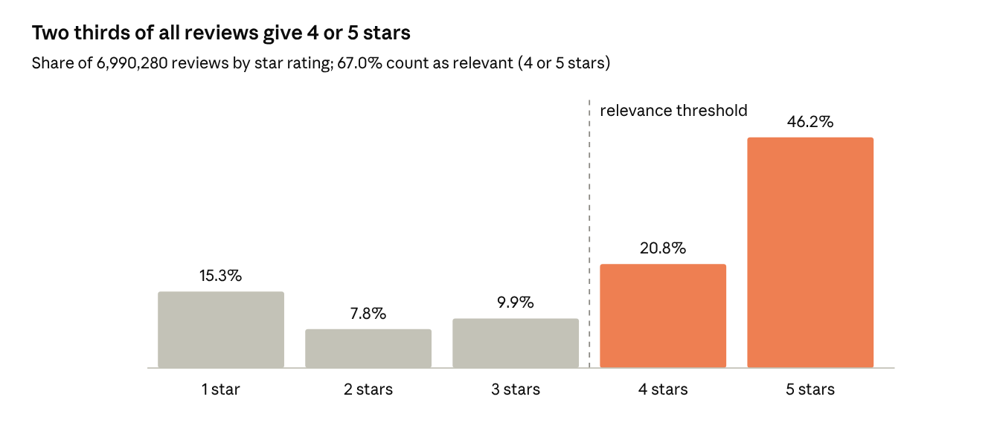 |
| E2 | 연도별 리뷰 수 | 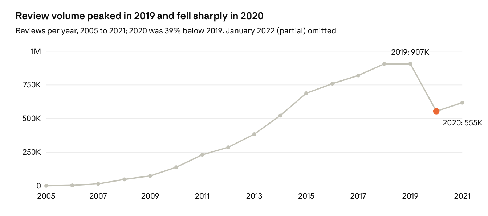 |
| E3 | 사용자·업체 리뷰 수 꼬리 분포 (log-log CCDF) | 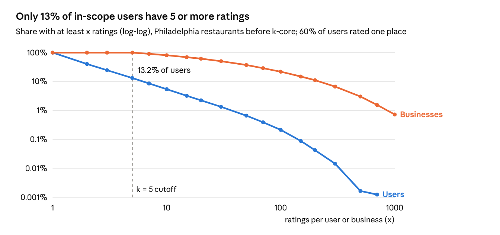 |
| E4 | 인기도 집중 (Lorenz curve) | 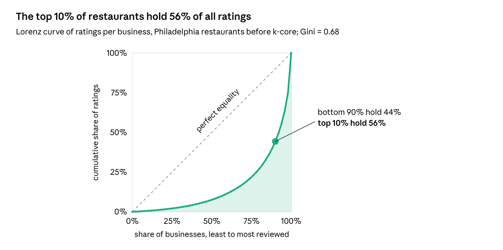 |
| E5 | 도시별 5-core 후 음식점 평점 수 | 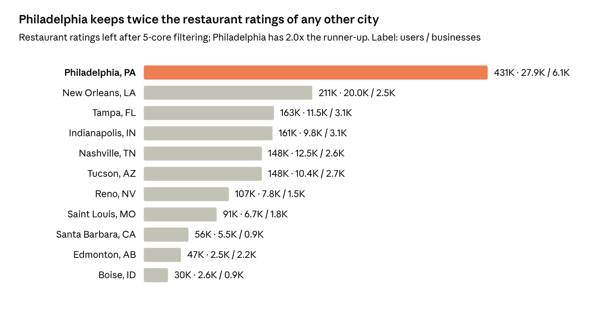 |
| E6 | 음식점 공간 밀도 | 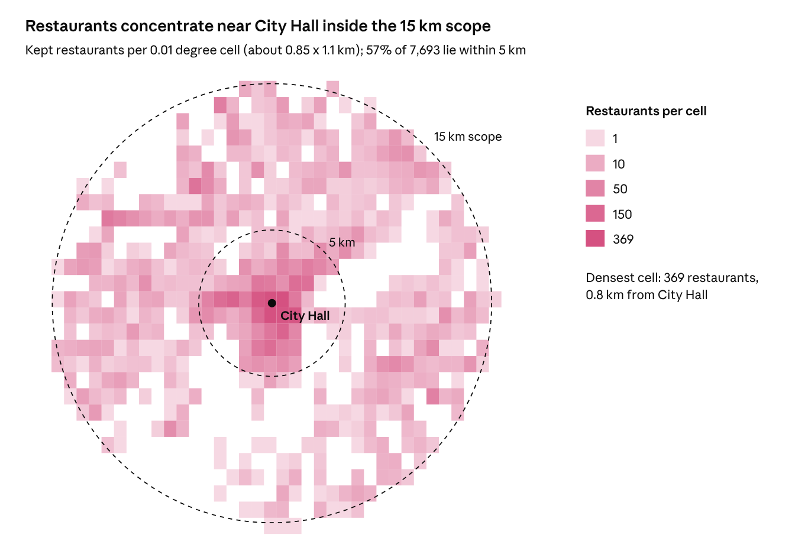 |
| E7 | 업체 간 거리 분포 | 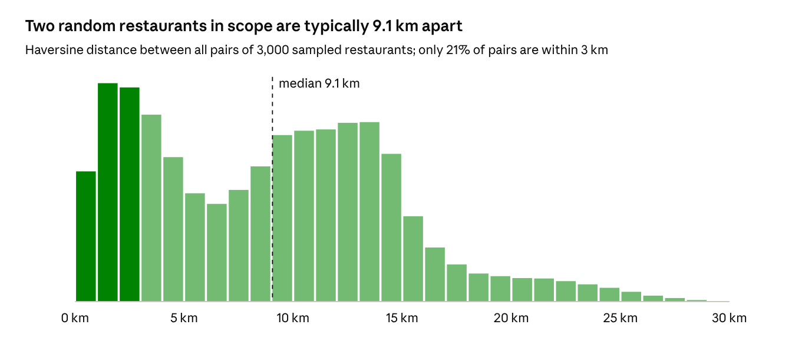 |
| E8 | 사용자 활동 반경 | 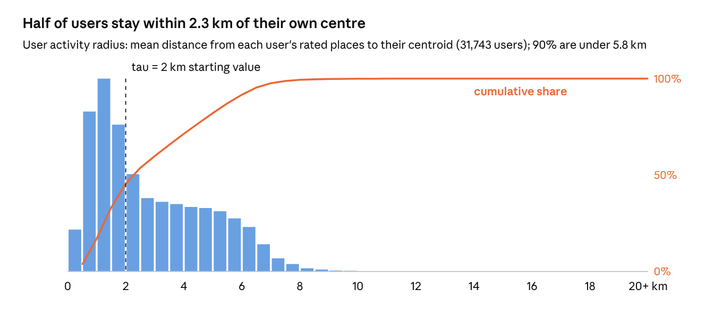 |
| E9 | 카테고리 빈도 | 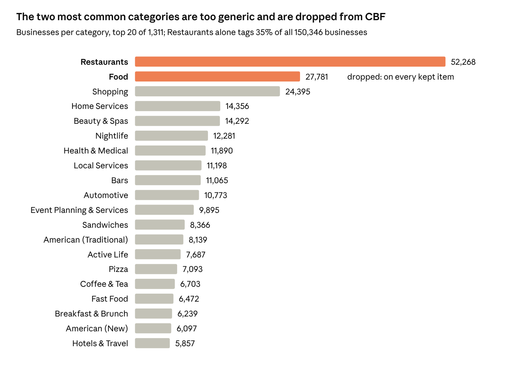 |
| E10 | 카테고리 동시출현 (Jaccard) | 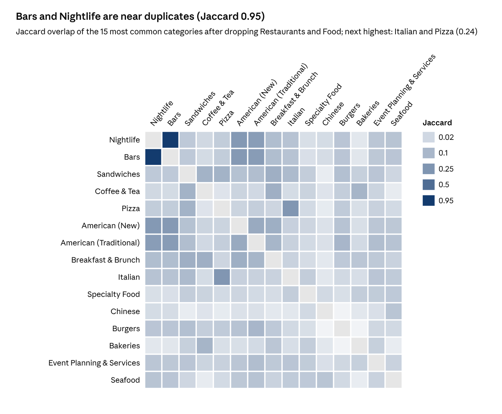 |
| E11 | 사용자·업체 평균 별점 분포 | 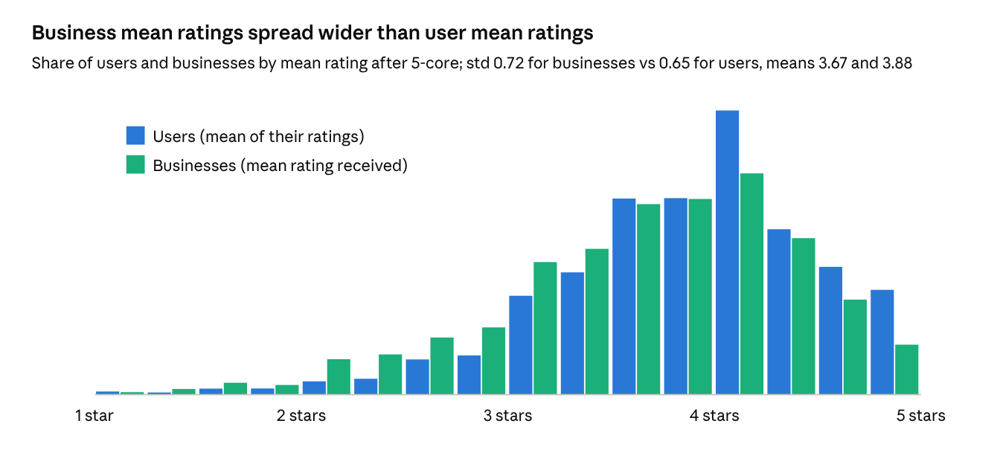 |
| E12 | 인기도와 평균 별점 | 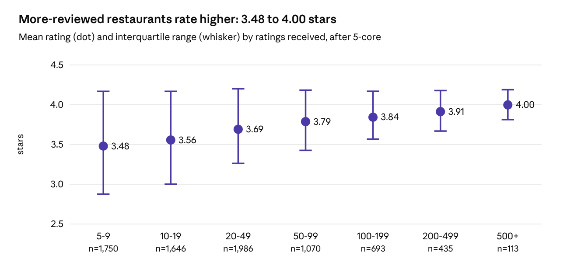 |
| E13 | k에 따른 데이터 감소 | 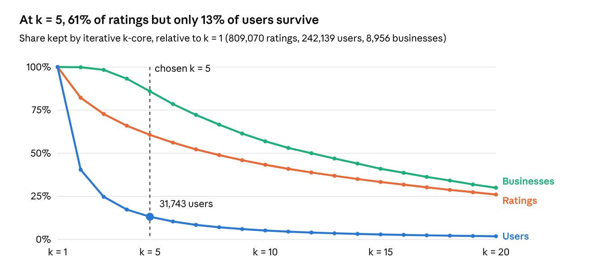 |
| P1 | 전처리 파이프라인 | 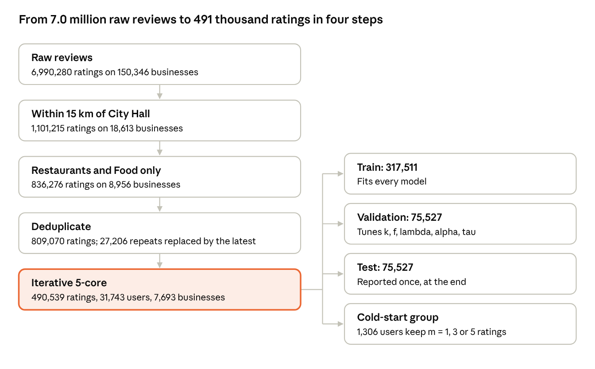 |
| P2 | 필터링 전후 별점 분포 | 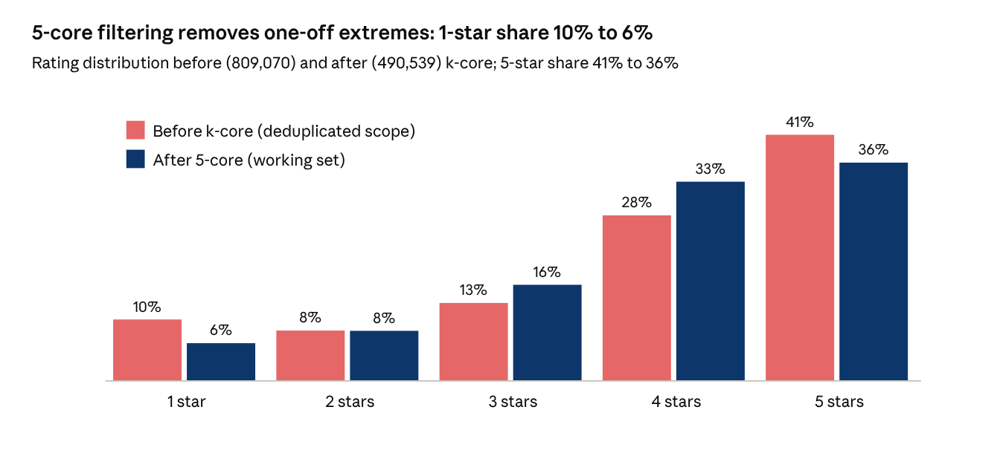 |
| P3 | 사용자 평균을 뺀 별점 분포 | 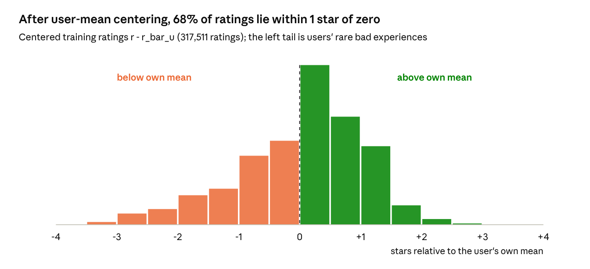 |
| P4 | train / validation / test 분할 | 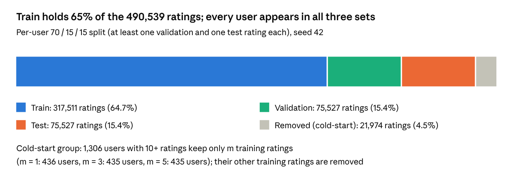 |
| P5 | 업체당 카테고리 수 | 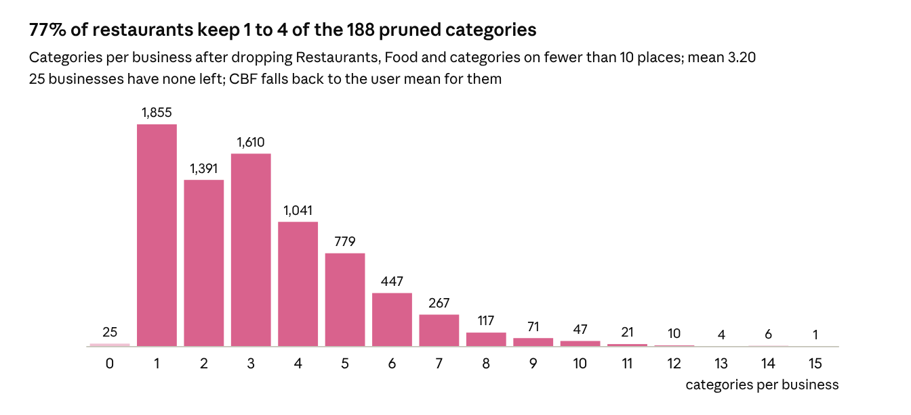 |

그림은 `results/figdata/`의 CSV로 그렸습니다. E1, E2, E5, E9는 `eda_full_dataset.py`가 출력하는 전체 데이터 통계로 그렸습니다.
