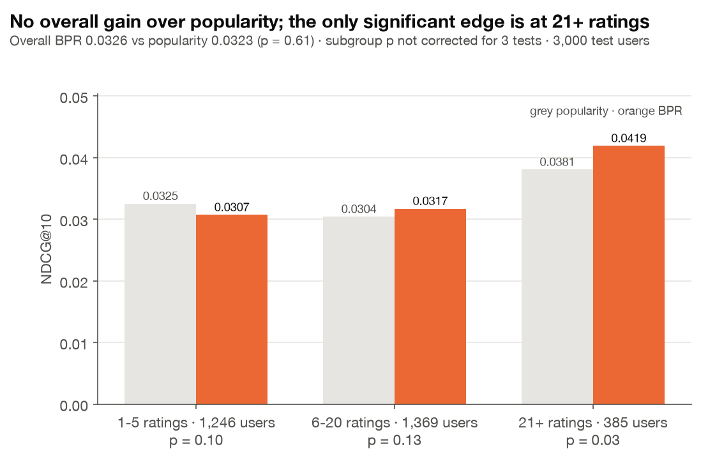

# 순위를 직접 학습하는 BPR

이슈 #52 · 코드 `src/tasteroute/models/bpr.py`, `experiments/bpr.py` · 결과 `results/bpr.json` · 그림 `figures/B1_bpr_by_activity.png`

## 한 줄 요약

별점 대신 **"어디에 갔는가"의 순위를 직접 학습하는 BPR**을 구현했다. 전체 test 3,000명에서 BPR은 인기순보다 낫다는 증거가 없었다(NDCG@10 +0.0003, p = 0.61). 활동량별로 나누면 평점 21개 이상 집단에서만 유의하게 높았지만(0.0419 vs 0.0381, p = 0.03; 6~20개 집단도 평균은 높으나 p = 0.13), 세 집단을 나눠 본 결과라 보정하면 유의하지 않고, validation에서도 확인되지 않았다. 결론은 **이 데이터에서는 학습 목표를 순위로 바꿔도 개인화 신호가 약하다**는 것이다.

## 왜 하나

지금까지의 모델(Bias, MF, CBF, Hybrid)은 "이 사람이 별점을 몇 점 줄까"를 맞히도록 학습했다. 그런데 추천 목록에 필요한 것은 "이 사람이 어디에 갈까"의 순위다. 그래서 별점 모델만으로는 인기순(P@10 0.0094)을 이기지 못했다 (D1).

**가설:** 손실함수를 순위에 맞추면(학습 목표 = 순위) 인기순을 넘을 수 있다.

## 모델

```
x_ui = b_i + p_u · q_i        사용자 u에게 장소 i의 점수 (b_i: 장소 편향 = 인기도, p_u · q_i: 개인 취향)
```

간 곳 i와 안 간 곳 j의 쌍마다 "i를 j보다 위에 놓을 확률"을 키운다.

```
최대화:  Σ ln σ(x_ui − x_uj) − (λ/2) (‖p_u‖² + ‖q_i‖² + ‖q_j‖² + b_i² + b_j²)
```

- **학습**: 미니배치(1,024쌍) 확률적 경사 상승. 기울기는 `σ(−x_uij)`(아직 덜 맞힌 정도)에 비례한다. 같은 사용자나 장소가 한 배치에 여러 번 나와도 갱신이 합쳐지도록 `np.add.at`을 쓴다.
- **음성 샘플링**: j는 전체 장소에서 무작위로 뽑고, 사용자가 이미 간 곳이면 다시 뽑는다 (정렬된 키 배열에서 `np.searchsorted`로 확인). 10번 다시 뽑아도 간 곳이면 그 쌍은 갱신에서 뺀다.
- **정규화 계수**: 목적함수의 λ/2 항을 미분하면 −λ·p_u이 되어, 코드의 갱신식(−λ·p_u)과 같다.
- **조기 종료**: 매 epoch validation NDCG@10을 재고, 5 epoch 동안 나아지지 않으면 멈춘 뒤 가장 좋았던 epoch의 파라미터로 되돌린다.
- **새 방문자**: 개인 벡터가 없으므로 장소 편향 b_i만으로 순위를 매긴다.

참고: S. Rendle et al., "BPR: Bayesian Personalized Ranking from Implicit Feedback", UAI 2009.

## 실험 설계 (test 누수 없음)

| 단계 | 데이터 |
| --- | --- |
| 하이퍼파라미터 선택 | validation 사용자 2,000명 (별점 4 이상 준 곳이 정답, train에서 간 곳만 제외) |
| 탐색 범위 | 정답 정의(train 방문 전체 / 별점 4 이상만) × 학습률 {0.01, 0.05} × f {32, 64, 128} × λ {1e-4, 1e-3} = 24개 |
| 선택 결과 | 별점 4 이상만, 학습률 0.05, f = 64, λ = 1e-4, 3번째 epoch (val NDCG@10 0.0379, 같은 사용자의 인기순 0.0367) |
| 평가 (한 번) | `experiments/ranking.py`와 같은 test 사용자 3,000명, 사용자마다 상위 10곳 |

## 결과 (test 3,000명)

| 방식 | P@10 | NDCG@10 | 평균 거리 | 커버리지 |
| --- | --- | --- | --- | --- |
| 인기순 | 0.0094 | 0.0323 | 3.0km | 0.32% |
| Hybrid blend | 0.0095 | 0.0323 | 3.0km | 0.34% |
| **BPR** | **0.0100** | 0.0326 | 3.0km | 0.42% |
| 인기순 + 거리 | 0.0107 | 0.0360 | 2.3km | 0.79% |
| Hybrid blend + 거리 | 0.0109 | **0.0373** | 2.1km | 1.01% |
| BPR + 거리 | 0.0105 | 0.0360 | 2.1km | **1.35%** |

거리 재순위화는 상위 200곳을 `e^(−d/2km)`로 다시 정렬했다.

| 사용자별 NDCG@10 paired t-test | 차이 | p |
| --- | --- | --- |
| BPR vs 인기순 | +0.0003 | 0.61 |
| BPR + 거리 vs 인기순 + 거리 | +0.0001 | 0.96 |
| BPR + 거리 vs Hybrid blend + 거리 | −0.0013 | 0.12 |

### 활동량별로 나눠 보면



| 학습 평점 수 | 사용자 | 인기순 | BPR | p |
| --- | --- | --- | --- | --- |
| 1~5개 | 1,246 | 0.0325 | 0.0307 | 0.10 |
| 6~20개 | 1,369 | 0.0304 | 0.0317 | 0.13 |
| 21개 이상 | 385 | 0.0381 | **0.0419** | 0.03 |

### 스위칭 하이브리드 (활동량에 따라 모델 고르기)

"평점이 T개 이상이면 BPR, 아니면 인기순"을 validation에서 T ∈ {1, 5, 10, 15, 20, 30, 50}으로 골랐다. **T = 1(항상 BPR)이 선택됐다.** validation에서는 평점이 적은 사용자에게도 BPR이 조금 나았기 때문이다. 그래서 test 결과는 BPR과 같다.

## 해석

1. **순위를 직접 학습해도 인기순과 차이가 없다.** 별점 모델(D1)에 이어 순위 모델로도 같은 결론이 나왔다. 데이터의 밀도가 0.20%이고 사용자당 학습 평점 중앙값이 6개라서, 개인 취향을 배울 신호가 적다.
2. **활동적 사용자에게서만 BPR이 앞섰지만, 확정할 수 없다.** 21개 이상 집단의 p = 0.03은 세 집단을 본 결과라 Bonferroni로 보정하면 0.09다. validation에서 고른 스위칭 기준도 이 패턴을 지지하지 않았다. **가설**로 남기고, 데이터가 더 쌓인 사용자에게 개인화가 이득일 가능성을 시사하는 정도로만 말한다.
3. **추천 다양성은 BPR이 가장 넓다.** 거리 재순위화를 합치면 커버리지가 1.35%로 표의 방식 중 가장 높다 (검정 없는 점 추정값). 인기순과 정확도 차이 없이 더 많은 가게를 보여 준다.
4. **거리 재순위화는 여기서도 모든 방식의 NDCG를 올린다.** RQ1 결론이 다시 확인됐다.

## 한계

- 정답은 "별점 4 이상 리뷰"라서 실제 방문 전체가 아니다.
- 음성 샘플을 균등하게 뽑아 인기 있는 장소가 음성으로 덜 뽑힌다. 인기도 비례 샘플링이나 WARP 손실은 시도하지 않았다.
- 학습이 3 epoch 근처에서 멈췄다. 더 긴 학습은 validation 점수를 낮췄다 (과적합).

## 재현

```bash
python experiments/bpr.py        # 약 3분, results/bpr.json, data/processed/bpr_model.npz
python experiments/figures.py    # B1 포함
pytest tests/test_bpr.py         # 집단 선호 학습, 음성 샘플, 조기 종료, 저장·불러오기
```
