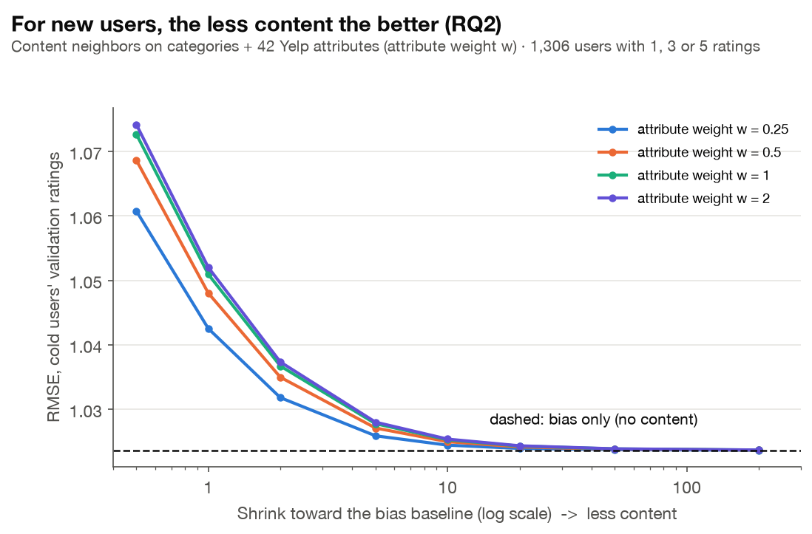

# 가게 속성으로 cold start 다시 보기 (RQ2)

이슈 #54 · 코드 `src/tasteroute/item_extras.py`, `src/tasteroute/models/content_knn.py`, `experiments/cold_start.py` · 결과 `results/cold_start.json` · 그림 `figures/C1_cold_start_shrink.png`

## 한 줄 요약

**RQ2의 답: 아니다.** 카테고리에 Yelp 가게 속성 42개를 더하고, 평점 하나로도 일반화하는 내용 기반 이웃 모델을 추가해도, 평점이 1·3·5개인 사용자의 오차는 bias 모델보다 줄지 않았다. 속성을 쓴 두 모델(CBF+속성, 내용 이웃)에서 validation은 **내용 정보를 최대한 끄는 설정**(탐색 범위의 끝)을 골랐다. 내용 정보가 클수록 오차가 커지고, 끌수록 bias 모델로 수렴한다. 카테고리만 쓴 CBF는 λ = 30(범위 중간)을 골랐지만 역시 bias와 차이가 없다.

## 왜 다시 보나

처음 실험에서 카테고리만 쓴 CBF는 cold-start 사용자에게서 bias와 0.002 이내였다 (RQ2 미해결). 실패 원인 후보는 두 가지였다.

1. **특성이 빈약하다**: 카테고리 188개만으로는 가게를 구별하기 어렵다.
2. **모델이 평점 몇 개로 학습하기 어렵다**: 사용자별 ridge는 평점 1개로 취향 벡터를 맞춰야 한다.

두 원인을 각각 고쳐 봤다.

## 무엇을 바꿨나

### 1. 특성 보강: Yelp 가게 속성 42개 (`item_extras.py`)

원본 `business.json`의 `attributes`를 0/1 특성으로 바꿨다.

| 묶음 | 특성 |
| --- | --- |
| 예/아니오 15개 | 포장, 배달, 야외석, 예약, 자전거 주차, TV, 단체석, 아이 동반, 케이터링, 테이블 서비스, 휠체어, 해피아워, 반려견, 드라이브스루, BYOB |
| 선택값 8개 | 주류(바/맥주·와인), 무료 와이파이, 소음(조용/시끄러움/매우 시끄러움), 복장(드레시/정장) |
| 하위 항목 19개 | 분위기 9개(로맨틱, 아늑함, 고급, 힙스터 …), 식사 시간대 6개(디저트, 심야, 점심, 저녁, 브런치, 아침), 주차 4개 |

- 카테고리와 같은 방식으로 IDF 가중치를 준다. 흔한 속성(포장 84%)보다 드문 속성(로맨틱)이 더 무겁다.
- 속성 묶음 전체에는 가중치 w를 곱해 카테고리와의 비중을 조절한다.
- Yelp는 `"u'free'"`, `"{'romantic': True}"` 같은 문자열로 저장해서 `ast.literal_eval`로 안전하게 읽었다.
- 같은 파일에서 **영업시간**도 추출했다 (대시보드의 영업시간 반영에 쓴다).

### 2. 평점 몇 개로도 되는 모델: 내용 기반 이웃 (`content_knn.py`)

```
r̂_ui = b_ui + Σ_j s_ij (r_uj − b_uj) / (Σ_j |s_ij| + shrink)
```

- j는 사용자가 평가한 가게, s_ij는 두 가게의 내용 벡터 cosine 유사도다.
- 사용자별로 학습할 것이 없다. 평점 1개만 있어도 그 가게와 닮은 모든 가게에 정보가 전해진다.
- `shrink`가 클수록 보정이 0으로 줄어 bias 예측에 가까워진다.

## 실험 설계 (test 누수 없음)

- **선택**: cold-start 사용자 1,306명의 **validation 평점 5,680개** RMSE로 모든 설정을 고른다.
  - Bias λ (5개)
  - CBF λ (6개)
  - CBF+속성 λ × w (24개)
  - 내용 이웃 shrink × w (32개)
- 모든 모델은 같은 bias 기준선(λ = 5) 위에 내용 보정만 다르게 얹는다.
- **평가**: test에서 한 번, cold 집단(학습 평점 1·3·5개)별과 warm 사용자에서 RMSE를 잰다. bias 대비 사용자별 MSE로 paired t-test를 한다.

## 결과

| 모델 (선택된 설정) | cold m=1 | cold m=3 | cold m=5 | warm |
| --- | --- | --- | --- | --- |
| Bias (λ = 5) | **1.0690** | **1.0255** | **1.0392** | 1.0508 |
| CBF 카테고리 (λ = 30) | 1.0692 | 1.0256 | 1.0397 | 1.0508 |
| CBF 카테고리+속성 (λ = 3000, w = 0.25) | 1.0690 | 1.0255 | 1.0392 | 1.0508 |
| 내용 이웃 (shrink = 200, w = 0.25) | 1.0690 | 1.0256 | 1.0393 | 1.0508 |

bias 대비 p값은 모두 0.19 이상이다. 차이가 없다.



C1 그림이 핵심이다. 내용 이웃 모델의 cold validation 오차는 다음처럼 움직인다.
- **shrink가 작을수록(내용 보정이 클수록) 커진다.** 예를 들어 shrink 0.5, w = 2에서 1.074다.
- **shrink를 키우면 bias 선(1.0236)으로 내려온다.**
- **속성 가중치 w도 작을수록 낫다.**
- CBF+속성도 같다. 정규화 λ를 범위 끝(3000)까지 키워도 계속 그 쪽을 골랐다.

## 해석

1. **이 데이터에서 내용 정보는 cold-start 사용자의 별점을 설명하지 못한다.** 가게 품질(장소 편향 b_i)과 사용자의 후한 정도(b_u)가 설명하고 남은 잔차에, 카테고리나 분위기 같은 내용 특성이 거의 신호를 주지 않는다.
2. **그래서 "최선의 내용 모델 = 내용을 끈 모델"이 된다.** 평점 1개짜리 사용자에게 "이 사람은 로맨틱한 곳을 좋아한다"고 일반화하면 오히려 틀린다.
3. **처음 세운 두 원인 후보는 모두 아니었다.** 특성을 188개에서 230개로 늘려도, 사용자별 학습이 필요 없는 모델을 써도 결과가 같다. 문제는 모델이나 특성의 양이 아니라 **별점이라는 목표에 담긴 개인 취향 신호의 크기**다. 순위 쪽 BPR 실험(#52)과 같은 결론이다.

## 한계

- 리뷰 본문(텍스트)은 쓰지 않았다. 텍스트 임베딩은 더 풍부한 내용 특성이 될 수 있지만 리뷰 699만 개 처리 비용이 크다.
- 별점(RMSE) 기준의 결론이다. cold 사용자의 **순위**(무엇을 보여 줄지)에는 인기도와 거리가 이미 강한 신호다 (D1, RQ1).

## 재현

```bash
python -m tasteroute.item_extras        # 원본에서 속성·영업시간 추출 → data/processed/item_extras.pkl
python experiments/cold_start.py        # 약 30초 → results/cold_start.json
python experiments/figures.py           # C1 포함
pytest tests/test_item_extras.py tests/test_content_knn.py
```
