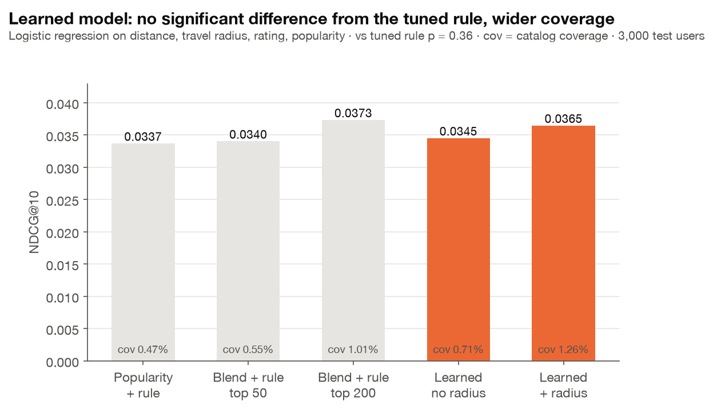
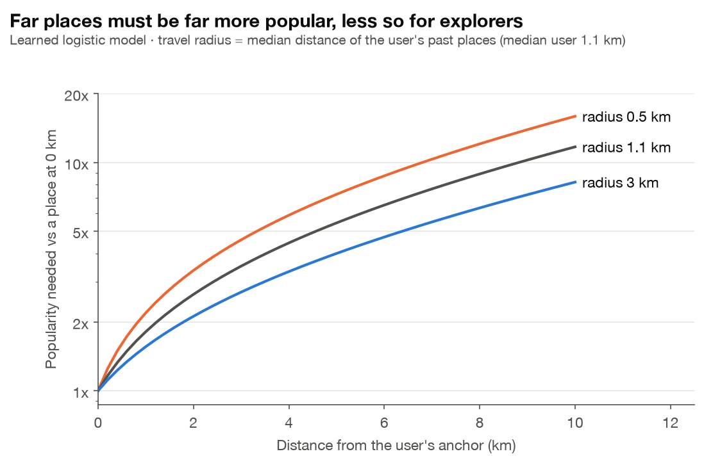

# 거리 민감도 학습 (로지스틱 회귀)

이슈 #48 · 코드 `src/tasteroute/models/visit.py`, `experiments/learned_distance.py` · 결과 `results/learned_distance.json` · 그림 `figures/L1_learned_vs_fixed.png`, `figures/L2_learned_distance_curve.png`

## 한 줄 요약

거리를 얼마나 중요하게 볼지를 사람이 정하던 규칙(`× e^(−d/2km)`)을 **로지스틱 회귀로 데이터에서 학습**했다. 학습 모델은 기존 설정보다 유의하게 정확하고(NDCG@10 +0.0024, p = 0.003), 검증으로 튜닝한 고정 규칙과는 정확도에서 유의한 차이를 찾지 못했다(평균 −0.0009, p = 0.36). 카탈로그 커버리지는 1.26%로 고정 규칙(1.01%)보다 넓었다 (검정 없는 점 추정값). **개인별 이동 반경**이 핵심 특성이다.

## 왜 하나

기존 거리 재순위화(RQ1)는 다음 규칙이다.

```
점수 = 예상 별점(0~1로 변환) × e^(−거리 / τ),  τ = 2km
```

- τ는 사람이 몇 개 값을 넣어 보고 고른 숫자이고, 모든 사용자에게 똑같다.
- 별점, 인기도, 거리를 섞는 비율이 식 모양으로 고정되어 있다.

질문을 바꿨다. **"이 사람이 이곳에 실제로 갈까?"** 를 맞히는 모델을 학습하면, 거리와 별점과 인기도의 상대적 중요도는 데이터가 정한다.

## 모델

```
P(방문 | 사용자 u, 장소 i) = σ(w · x(u, i) + b),   σ(z) = 1 / (1 + e^−z)
```

| 특성 | 의미 |
| --- | --- |
| `log1p(d)` | 사용자 기준점에서 장소까지 거리(km)의 로그. 처음 1km가 열 번째 1km보다 크게 느껴지는 효과 |
| `d` | 같은 거리, 선형. 먼 곳을 꾸준히 깎는 효과 (고정 규칙 `e^(−d/τ)`는 로그로 보면 선형) |
| `log1p(d / ρ_u)` | **개인별 이동 반경 ρ_u** 대비 거리. ρ_u = 사용자가 학습 데이터에서 간 장소들의 기준점 거리 중앙값 (최소 0.5km). 평소 5km씩 다니는 사람에게 3km는 가깝다 |
| `r̂` | Hybrid 모델의 예상 별점 |
| `log1p(pop)` | 학습 데이터에서 그 장소의 평점 수 (인기도) |

### 학습 (수업 내용 그대로 직접 구현)

- **손실**: 평균 cross-entropy + L2 정규화 `L = −mean(y log p + (1−y) log(1−p)) + λ/2 ‖w‖²`
- **기울기**: `∂L/∂w = Xᵀ(p − y)/n + λw`, `∂L/∂b = mean(p − y)`
- **경사하강법 + backtracking line search**: 한 걸음이 손실을 `lr/2 · ‖∇L‖²` 이상 줄이지 못하면 걸음 크기를 반으로 줄여 다시 시도하고(Armijo 조건), 성공하면 다음 걸음은 두 배로 키운다.
  - 방문은 후보 200곳 중 약 1곳뿐이라 손실 면이 매우 평평하다. 고정 걸음으로는 수만 번 돌아야 했는데(테스트로 확인), 이 방식으로는 20~150번 만에 수렴한다.
- **표준화**: 특성마다 평균 0, 분산 1로 맞춘 뒤 학습해서 하나의 걸음 크기로 모든 특성을 다룬다. 해석할 때는 `coef()`로 원래 단위로 되돌린다.
- 수치 안정성: `σ`와 손실을 `np.logaddexp`로 계산해서 `e^z`가 넘치지 않게 했다.

## 데이터 구성 (test 누수 없음)

| 단계 | 데이터 | 정답 |
| --- | --- | --- |
| 학습 | validation 사용자 6,000명, 각자 blend 점수 상위 200곳 (370,400행, 정답 2,687개) | validation에서 별점 4 이상 준 곳 |
| λ·특성 선택 | 위 사용자 중 20%를 떼어 둔 holdout | 같음 |
| 평가 (한 번) | `experiments/ranking.py`와 같은 test 사용자 3,000명 | test에서 별점 4 이상 준 곳 |

- 사용자 기준점과 이동 반경은 train 데이터로만 계산한다.
- 후보 200곳 안에 정답이 하나도 없는 사용자는 순위 정보를 주지 않으므로 학습에서 뺐다.
- **공정한 비교**: 고정 규칙도 같은 holdout과 같은 후보 200곳에서 τ를 {0.5, 1, 1.5, 2, 3, 5} 중에서 골랐다 (τ = 2가 다시 선택됨).

## 결과 (test 3,000명)

| 방식 | P@10 | NDCG@10 | 목록 평균 거리 | 커버리지 |
| --- | --- | --- | --- | --- |
| 인기순 + 고정 규칙 | 0.0100 | 0.0337 | 2.7km | 0.47% |
| blend + 고정 규칙, 후보 50곳 (기존 설정) | 0.0102 | 0.0340 | 2.6km | 0.55% |
| blend + 고정 규칙, 후보 200곳, τ 튜닝 | 0.0109 | **0.0373** | 2.1km | 1.01% |
| 학습 모델, 개인 반경 없음 | 0.0106 | 0.0345 | 2.7km | 0.71% |
| **학습 모델 + 개인 반경** | **0.0110** | 0.0365 | 2.4km | **1.26%** |

사용자별 NDCG@10 paired t-test:

| 비교 | 차이 | p |
| --- | --- | --- |
| 학습 + 반경 vs 기존 설정 (후보 50) | +0.0024 | **0.003** |
| 학습 + 반경 vs 튜닝한 고정 규칙 (후보 200) | −0.0009 | 0.36 (유의한 차이 못 찾음) |
| 학습, 반경 없음 vs 튜닝한 고정 규칙 | −0.0028 | 0.037 (더 나쁨) |



## 해석

1. **후보를 넓히는 게 가장 큰 개선이다.** 고정 규칙도 후보를 50곳에서 200곳으로 늘리자 NDCG가 0.0340에서 0.0373으로 올랐다. 거리를 반영하려면 먼저 가까운 후보가 후보군 안에 들어와 있어야 한다.
2. **개인 이동 반경이 중요하다.** 반경 특성을 빼면 학습 모델은 튜닝한 고정 규칙보다 유의하게 나쁘고(p = 0.037), 넣으면 유의한 차이가 사라진다(p = 0.36). "가깝다"는 사람마다 다르다는 해석과 맞는다.
3. **학습 모델은 튜닝한 규칙과 정확도 차이를 보이지 않으면서 커버리지가 넓다.** 커버리지가 1.01%에서 1.26%로 늘었다. 다만 이 값은 test 3,000명에서 한 번 잰 점 추정값이고 신뢰구간은 구하지 않았다. 개인 반경이 사용자마다 다른 거리대의 장소를 올려 준다는 설명은 **가설**이며, 이를 따로 검증한 실험은 없다. "p = 0.36"은 차이의 증거가 없다는 뜻이지 두 방법이 같다는 증거는 아니다 (표본 평균은 학습 모델이 0.0009 낮다).
4. **학습된 가중치가 거리의 값을 말해 준다.** 중앙값 사용자(반경 1.1km) 기준으로, 1km 지점에서 1km 더 멀어지는 손해는 **인기도가 1.56배인 곳**이어야 상쇄된다. 예상 별점으로 환산하면 2.55점이다. 예상 별점의 가중치가 작다(표준화 계수 0.006, 인기도 0.036, 거리 세 항 합 −0.061). 이는 "별점 모델은 순위 신호가 약하고, 인기도와 거리가 신호를 만든다"는 D1 결론과 같다.



L2 그림은 학습 모델이 보는 거리 비용을 인기도 배수로 나타낸 것이다. 반경 0.5km인 사람에게 5km 떨어진 곳은 약 7.3배 더 인기 있어야 하지만, 반경 3km인 사람에게는 4배면 된다 (중앙값 사용자는 5.4배).

## 선택된 설정

- 특성: 5개 전부 (`with_radius`), λ = 0.1
- holdout NDCG@10: 0.0318 (고정 규칙 τ = 2: 0.0316)
- holdout 점수 차이는 0.003 안쪽이라 λ 선택 자체는 잡음 수준이다. 그래서 결론은 test 결과와 paired t-test로만 말한다.

## 한계

- 거리는 직선거리다. 도보 거리(`roads.py`)를 특성으로 쓰려면 사용자-장소 쌍 수십만 개의 도보 거리가 필요해서, 넓은 도로망 다운로드가 필요하다. 다음 단계 후보다.
- 로지스틱 회귀는 행 하나하나의 확률을 맞추는 모델이다 (pointwise). 순위 자체를 직접 최적화하는 방법(pairwise, 예: BPR)은 다루지 않았다.
- 정답이 "별점 4 이상 리뷰"라서 실제 방문 전체가 아니다. 리뷰를 쓰지 않은 방문은 보이지 않는다.

## 대시보드·파이프라인에서 쓰기

학습된 모델은 `results/learned_distance.json`의 `model.params`에 저장된다. `pipeline.plan_day(..., visit=(model, features, columns))`로 넘기면 고정 규칙 대신 학습 모델로 순위를 매긴다. 새 방문자는 이동 반경으로 중앙값 사용자의 반경(1.1km)을 쓴다.

## 재현

```bash
python experiments/learned_distance.py   # 약 30초, results/learned_distance.json
python experiments/figures.py            # L1, L2 포함 그림 12장
pytest tests/test_visit.py               # 로지스틱 회귀, 특성, 순위 테스트
```
