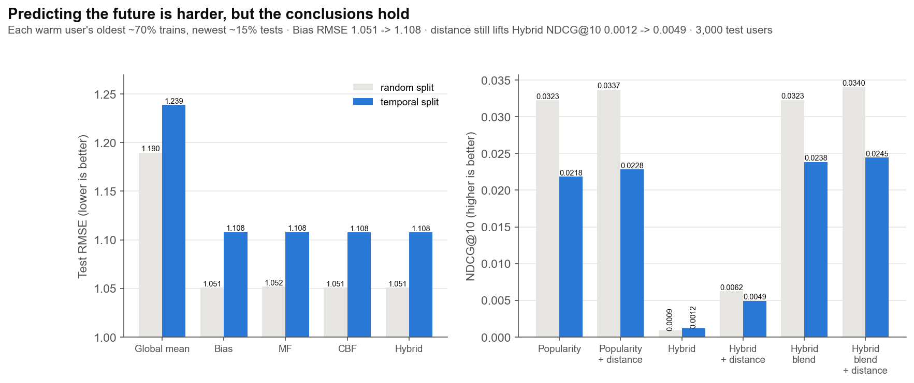

# 시간순 분할로 다시 평가하기

이슈 #67 · 코드 `src/tasteroute/data.py`의 `temporal_split`, `experiments/temporal.py` · 결과 `results/temporal.json` · 그림 `figures/S1_temporal_split.png` · 테스트 `tests/test_temporal.py`

## 한 줄 요약

과거로 학습해 미래를 맞히면 대부분의 지표가 나빠진다(원래 값이 매우 작은 Hybrid 단독 NDCG@10만 0.0009 → 0.0012로 올랐다). 별점 RMSE는 Bias, MF, CBF, Hybrid 모두 약 0.057 오르고(전체 평균은 0.049), 순위 NDCG@10은 21~32% 떨어진다. 그래도 결론은 같다.
- 별점 모델끼리는 여전히 거의 같다.
- 거리 재순위화는 여전히 정확도를 올리고 이동거리를 줄인다.
- 순위 신호는 여전히 대부분 인기도와 거리에서 나온다.

## 왜 다시 보나

전처리(`data_analysis_preprocessing/preprocess.py`)는 사용자마다 평점을 무작위로 섞은 뒤 70 / 15 / 15로 나눈다. 그래서 학습에 미래의 평점이 섞인다. warm 사용자의 **87.7%**는 test 평점보다 나중 날짜의 평점을 train에 하나 이상 가지고 있다. 실제 서비스는 과거 기록만 보고 다음 방문을 추천하므로, 이 누수가 결론을 바꾸는지 확인한다.

## 무엇을 바꿨나

`temporal_split(ratings)`가 warm 사용자(`cold_m == 0`)의 평점을 사용자마다 날짜순으로 정렬해 다시 나눈다.

- 크기 규칙은 전처리와 같다: validation = test = max(1, round(0.15 × n)), 나머지가 train
  - 사용자별 train / val / test 개수가 무작위 분할과 정확히 같다
- 가장 오래된 평점이 train, 그다음이 val, 가장 최근이 test다. 날짜가 같으면 가게 id 순으로 정해 결과가 매번 같다
- cold-start 사용자는 원래 분할을 그대로 둔다. 두 실험에서 학습 데이터에 더해지는 cold 사용자의 평점이 같아야 비교가 공정하다
- `preprocess.py`와 `data/processed/`, 기존 결과 파일은 건드리지 않는다. 새 split 열은 실험 안에서만 만든다

| 분할 | train | val | test | 누수 사용자 비율 |
| --- | --- | --- | --- | --- |
| 무작위 (기존) | 313,595개, 중앙 날짜 2015-10 | 69,847개, 2015-10 | 69,847개, 2015-10 | 87.7% |
| 시간순 | 313,595개, 중앙 날짜 2015-01 | 69,847개, 2017-01 | 69,847개, 2018-05 | 0% |

## 실험 설계

- 하이퍼파라미터는 시간순 validation에서 다시 골랐다 (test는 마지막에 한 번)
  - Bias λ ∈ {1, 5, 10, 25} → 5
  - CBF λc ∈ {3, 10, 30, 100} → 30
  - Hybrid κ ∈ {1, 10, 100, 1000} → 100
  - 세 값 모두 무작위 분할과 같게 나왔다
  - MF는 f = 10, λ = 0.1을 그대로 쓰고 시간순 validation으로 조기 종료했다
- 순위 실험은 `experiments/ranking.py`, `experiments/popularity.py`와 같은 방식이다
  - test 사용자 3,000명, 관련 = test 별점 4 이상, 후보 50개 → 상위 10개, 거리 재순위화는 지수 감쇠 τ = 2km
  - 인기도 blend의 γ는 시간순 validation 사용자 3,000명에서 NDCG@10으로 다시 골랐다: γ = 2 (무작위 분할에서는 5)

## 결과

### 별점 예측 (warm test 평점 69,847개)

| 모델 | 무작위 분할 RMSE | 시간순 분할 RMSE [95% CI] | 차이 | bias 대비 p (시간순) |
| --- | --- | --- | --- | --- |
| 전체 평균 | 1.190 | 1.239 [1.231, 1.248] | +0.049 | < 0.001 |
| Bias | 1.051 | 1.108 [1.100, 1.117] | +0.057 | - |
| MF | 1.052 | 1.108 [1.099, 1.117] | +0.056 | 0.28 |
| CBF | 1.051 | 1.108 [1.100, 1.116] | +0.057 | < 0.001 |
| Hybrid | 1.051 | 1.108 [1.100, 1.117] | +0.057 | < 0.001 |

- 미래를 맞히는 쪽이 네 모델 모두 약 0.057 어렵다. 사용자 취향과 가게 평판이 시간에 따라 변하기 때문이다.
- 모델 간 순서와 차이의 크기는 그대로다. 네 모델이 0.0005 안에 있다.
- CBF와 Hybrid는 시간순에서 bias보다 통계적으로 유의하게 낮지만(p < 0.001), 차이는 0.0004~0.0005로 실질적인 의미는 없다. 표본이 7만 개라 아주 작은 차이도 유의하게 나온다.

### 순위 (test 사용자 3,000명)

| 방법 | NDCG@10 무작위 → 시간순 | P@10 무작위 → 시간순 | 목록 평균 거리 (시간순) |
| --- | --- | --- | --- |
| 인기순 | 0.0323 → 0.0218 | 0.0094 → 0.0061 | 3.1km |
| 인기순 + 거리 | 0.0337 → 0.0228 | 0.0100 → 0.0065 | 2.7km |
| Hybrid | 0.0009 → 0.0012 | 0.0004 → 0.0005 | 5.0km |
| Hybrid + 거리 | 0.0062 → 0.0049 | 0.0018 → 0.0016 | 2.3km |
| Hybrid blend | 0.0323 → 0.0238 | 0.0095 → 0.0067 | 3.1km |
| Hybrid blend + 거리 | 0.0340 → 0.0245 | 0.0102 → 0.0071 | 2.7km |

- 순위 지표는 21~32% 떨어진다. Hybrid 단독만 원래 값이 너무 작아 오히려 조금 올랐다.
- **RQ1 결론 유지**: 거리 재순위화는 시간순에서도 Hybrid의 NDCG@10을 4.1배(0.0012 → 0.0049) 올리고 목록 평균 거리를 5.0km → 2.3km로 줄인다.
- **랭킹 결론 유지**: 가장 좋은 방법은 여전히 Hybrid blend + 거리이고, 인기도와 거리가 순위 신호의 대부분을 낸다.
- 무작위 분할에서 Hybrid blend는 인기순과 같았다(0.0323 vs 0.0323). 시간순에서는 9% 높다(0.0238 vs 0.0218). 개인화가 미래 예측에서 조금 더 도움이 될 수 있다는 신호다. 다만 이 비교는 점 추정이고 유의성 검정은 하지 않았다.



## 한계

- 사용자마다 자기 기록 안에서 날짜순으로 나눴다. 전체 기간을 한 날짜로 자르는 전역 시간 분할은 아니다. 그래서 어떤 사용자의 test가 다른 사용자의 train보다 이를 수 있다(사용자 간 누수). 전역 분할은 사용자별 test가 비는 경우가 많아 이번 범위에서 뺐다.
- 후보 필터와 사용자 기준점은 시간순 train으로 다시 만들었지만, 가게의 영업 여부(`is_open`)는 2022년 데이터 시점 값이다.
- 순위 지표의 무작위 / 시간순 비교는 점 추정이다.

## 다시 돌리기

```bash
python experiments/compare_models.py   # 무작위 분할 기준값 (이미 있으면 생략)
python experiments/ranking.py
python experiments/popularity.py
python experiments/temporal.py
python experiments/figures.py
```
