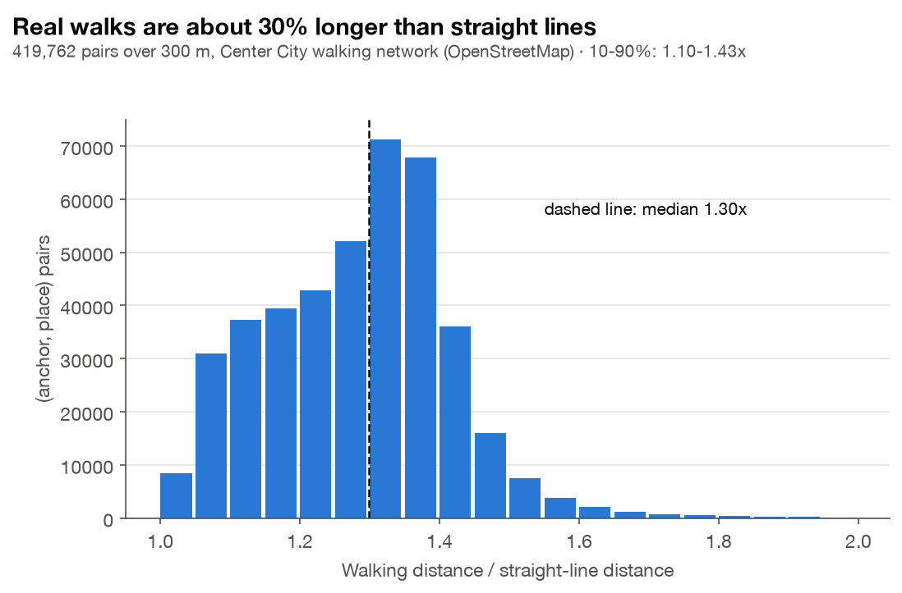
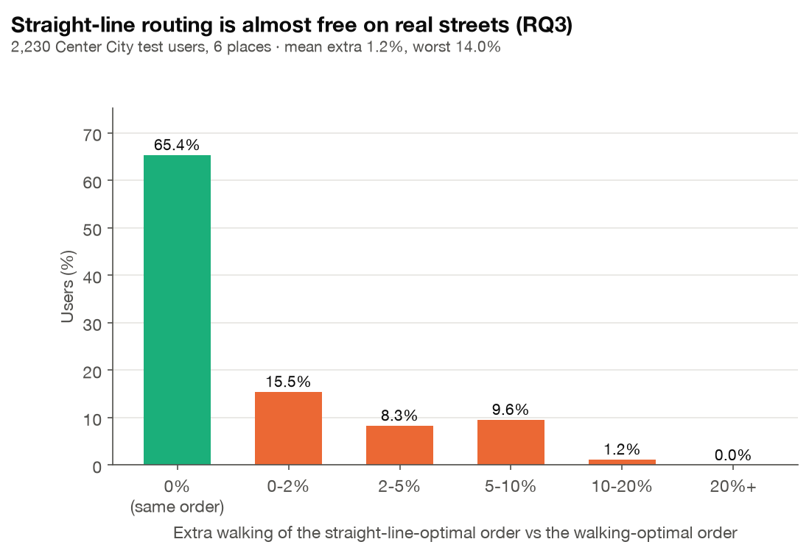

# 실제 도보 거리로 RQ1·RQ3 다시 재기

이슈 #56 · 코드 `experiments/walking.py`, `src/tasteroute/roads.py` (`distances_from`, `contains`) · 결과 `results/walking.json` · 그림 `figures/W1_walking_detour.png`, `figures/W2_route_on_streets.png`

## 한 줄 요약

도심 test 사용자 2,230명을 실제 보행 도로망 거리로 다시 쟀다.
- **실제로 걷는 거리는 직선보다 중앙값 1.30배 길다.**
- **RQ1**: 도보 거리로 재순위화해도 정확도에서 유의한 차이를 찾지 못했다(NDCG@10 +0.0002, p = 0.61; 같다는 증거는 아니다). 추천 목록의 실제 도보 거리 평균은 1.27km에서 1.21km로 5% 짧았다 (검정 없는 점 추정값).
- **RQ3**: 직선거리로 최적화한 방문 순서가 65%의 사용자에게는 도보로도 최적이다. 나머지도 평균 1.2%, 최악 14%만 더 걷는다.

**결론: 직선거리는 실험용 근사로 충분하다.** 실제 길은 화면에 보여 줄 경로와 시간을 위해 필요하다.

## 왜 하나

RQ1(거리 재순위화)과 RQ3(동선 최적화)의 숫자는 모두 직선거리 기준이다. 실제로 걸으면 블록을 돌아가야 하니, 다음 두 가지를 확인한다.
1. 직선거리로 내린 결론(순위, 동선)이 실제 길에서도 유지되는가?
2. 직선거리를 쓰는 비용은 얼마인가?

## 방법

- **도로망**: `python -m tasteroute.roads`로 받은 도심 보행 도로망 (OpenStreetMap, 노드 55,132개, 길 토막 134,354개, 북 39.978 / 남 39.928 / 동 −75.128 / 서 −75.205)
- **대상**: 기준점이 도로망 안(가장자리에서 0.5km 이상 안쪽)에 있는 사용자
  - test 2,230명 (`ranking.py`의 3,000명 중)
  - validation 1,500명
- **후보**: Hybrid blend 점수 상위 200곳 중 도로망 안의 가게 (3,652곳 중에서)
- **거리**
  - 직선: haversine
  - 도보: 기준점에서 한 번의 Dijkstra로 후보 전체까지 계산 (`RoadNetwork.distances_from`)
  - 가장 가까운 도로 노드 찾기는 KD-tree(`scipy.spatial.cKDTree`)로 바꿔 빠르게 했다

### RQ1
- 후보를 `점수 × e^(−d/τ)`로 재순위화한다. d로는 직선거리와 도보 거리를 각각 쓴다.
- τ는 거리 종류마다 validation에서 {0.5, 1, 1.5, 2, 3, 5, 8, 12, 20} 중에 고른다. 둘 다 5km가 선택됐다. 도심 안이라 거리가 짧아서 전체 도시의 2km보다 크다.
- 두 목록의 거리는 **둘 다 실제 도보 거리로** 재서 비교한다.

### RQ3
- 직선 재순위화 상위 6곳의 방문 순서를 두 번 Held-Karp로 구한다. 한 번은 직선거리 행렬, 한 번은 도보 거리 행렬을 쓴다.
- 두 순서를 실제로 걸었을 때의 거리를 비교한다.

## 결과

### 우회 계수



기준점-가게 쌍 419,762개(300m 이상)의 도보/직선 비율은 다음과 같다.
- 중앙값 **1.30배**
- 10~90% 구간 1.10~1.43배

바둑판 도로에서 대각선 방향으로 가면 최대 √2 ≈ 1.41배가 되는 것과 맞는다.

### RQ1: 도보 거리로 재순위화

| 재순위화 기준 | τ | NDCG@10 | P@10 | 목록의 실제 도보 거리 |
| --- | --- | --- | --- | --- |
| 직선거리 | 5km | 0.0396 | 0.0122 | 1.27km |
| 도보 거리 | 5km | **0.0398** | **0.0125** | **1.21km** |

- 정확도 차이: +0.0002, p = 0.61 (유의하지 않음)
- 도보 거리로 재순위화하면 추천 목록이 실제로 5% 가까워진다.

### RQ3: 직선거리로 짠 동선을 실제로 걸으면



| 지표 (2,230명, 6곳) | 값 |
| --- | --- |
| 직선 최적 순서가 도보로도 최적인 비율 | **65.4%** |
| 직선 최적 순서로 걸을 때 더 걷는 거리 | 평균 1.2%, 90번째 백분위 5.6%, 최악 14.0% |
| 최적 동선의 도보/직선 길이 (중앙값) | 1.34배 |
| 추천 순서 그대로 걸으면 (중앙값) | 최적보다 62% 더 걷는다 |

## 해석

1. **직선거리는 순서를 정하는 데 좋은 근사다.** 바둑판 도로라서 직선이 가까운 곳은 걸어도 대체로 가깝다. 거리가 1.3배씩 고르게 늘어나니 상대적인 순서는 거의 그대로다. 그래서 RQ1의 정확도와 RQ3의 순서 결론이 실제 길에서도 유지된다.
2. **절대 거리와 시간은 직선으로 재면 30% 과소평가된다.** 사용자에게 "몇 분 걸린다"를 보여 줄 때는 실제 도보 거리가 필요하다. 대시보드와 데모가 실제 길을 쓰는 이유다.
3. **동선 최적화는 실제 길에서도 크게 줄여 준다.** 도심 안에서 추천 순서 그대로 걸으면 최적보다 중앙값 62% 더 걷는다. 도시 전체·직선 기준 RQ3(26%)보다 크지만, 대상 사용자와 τ(5km vs 2km)가 달라서 두 숫자를 직접 비교하지는 않는다.

## 한계

- 도심 상자 안의 사용자와 가게만 다뤘다. 도시 외곽은 길이 덜 촘촘해서 우회 계수가 더 클 수 있다.
- 보행 시간은 거리 ÷ 시속 4.5km로만 계산했다. 신호와 경사는 반영하지 않았다.

## 재현

```bash
python -m tasteroute.roads          # 도심 도로망 받기 (약 2분, 한 번)
python experiments/walking.py       # 약 1분 → results/walking.json
python experiments/figures.py       # W1, W2 포함
```
