# TasteRoute: Preference-Based Place Recommendation and Route Planning

Final Report · Machine Learning Term Project, Gachon University · November 2026

Team: 이태현 (leten02), 효빈 (Hyobin0515), 건희 (Bae-kunhee), 가경 (GaKingOh) · Code: https://github.com/leten02/TasteRoute

## Summary

TasteRoute recommends restaurants a user is likely to enjoy, re-ranks them so they are reachable in a day, and orders the final places into the shortest visiting route. It is trained and evaluated on 490,539 Yelp ratings of 7,693 restaurants within 15 km of Philadelphia City Hall.

| Question | Answer | Evidence |
| --- | --- | --- |
| Which rating model is best? | Bias, MF, CBF and Hybrid tie at test RMSE 1.051 to 1.052; Item-kNN 1.121, global mean 1.190 | Section 9.1 |
| RQ1: what does adding distance cost? | Nothing: with exponential decay (tau = 2 km) the mean list distance falls 6.3 → 2.1 km and Hybrid NDCG@10 rises 0.0009 → 0.0062 | Section 9.2 |
| RQ2: does CBF help cold-start users? | No: with 1, 3 or 5 training ratings, CBF and Hybrid stay within 0.002 RMSE of the bias model, also with 42 extra place attributes | Section 9.3 |
| RQ3: heuristic vs exact route? | NN + 2-opt is exactly optimal for 82% of users (mean gap 0.9%); visiting in recommendation order walks 26% more (median); Held-Karp takes 0.9 ms for 8 places | Section 9.4 |
| Do the conclusions survive a time-ordered split? | Yes: all metrics get worse, but model order and the distance effect hold | Section 9.6 |

The strongest ranking signals in this data are popularity and distance, not predicted ratings. Popularity alone beats every rating model on Precision@10 (0.0094 vs 0.0004 to 0.0005), and the best list blends the Hybrid prediction with log popularity and then re-ranks by distance.

## 1. Overview

We build a system that recommends Top-N places a user is likely to enjoy, re-ranks them so they are actually reachable, and plans a one-day visiting route through the final N places.

- Domain: place and restaurant recommendation on Yelp business reviews.
- Problem: rating prediction alone pushes far-away places to the top, and place data is far sparser than movie data (median 1 review per user, 99.998% sparsity).
- Approach: machine learning (CF, CBF, Hybrid) produces candidates; deterministic algorithms handle distance re-ranking and route optimization.

Research questions:

1. RQ1: How much ranking accuracy is lost, and how much travel distance is saved, when distance is added to the ranking?
2. RQ2: Does content-based filtering reduce error for users with few ratings (cold start)?
3. RQ3: How close does a fast heuristic route (nearest neighbor + 2-opt) come to the exact optimum, and at what speed?

The end-to-end score for user u and place i is a rating prediction discounted by distance:

$$
\text{score}(u,i) = \hat{r}_{ui} \cdot w\big(d(\ell_u, \ell_i)\big)
$$

where the predicted rating comes from one of the recommenders, d is the haversine distance between the user anchor and the place, and w is a decreasing weight in [0, 1].

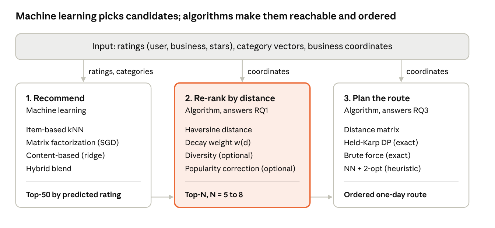{width=6.3in}

## 2. Dataset

We use the Yelp Open Dataset (January 2022 release, [yelp.com/dataset](https://www.yelp.com/dataset)): 6,990,280 reviews by 1,987,929 users on 150,346 businesses. The archive is 4.34 GB compressed and 8.65 GB once extracted into five JSON files.

| File | Size | Records | Fields we use | Role |
| --- | --- | --- | --- | --- |
| business.json | 119 MB | 150,346 | business_id, latitude, longitude, categories, is_open, hours, attributes | Item features, location, opening hours |
| review.json | 5.34 GB | 6,990,280 | user_id, business_id, stars, date | Rating matrix (target) |
| checkin.json | 287 MB | 131,930 businesses | not used | - |
| tip.json | 181 MB | 908,915 | not used | - |
| user.json | 3.36 GB | 1,987,897 | not used (mostly friend lists) | - |

| Property of the full data | Value | Consequence |
| --- | --- | --- |
| Rating matrix density | 0.0023% | CF needs aggressive filtering |
| Reviews per user, median | 1 (57.1% of users have one review) | Cold start is the default case |
| Reviews per business, median | 15 | Items are better covered than users |
| Mean rating | 3.75 | Global-mean baseline is strong |
| Duplicate (user, business) pairs | 244,520 (3.5%) | Need a dedup rule |
| Closed businesses | 20.4% | Train on them, never recommend them |
| Distinct categories | 1,311 (mean 4.45 per business) | Needs pruning and weighting |

$$
\rho = \frac{|\mathcal{R}|}{|\mathcal{U}|\,|\mathcal{I}|} = \frac{6{,}990{,}280}{1{,}987{,}929 \times 150{,}346} \approx 2.34 \times 10^{-5}
$$

## 3. Exploratory data analysis

The EDA justified four decisions: which city, which k-core threshold, how far a user is willing to travel, and which categories to keep.

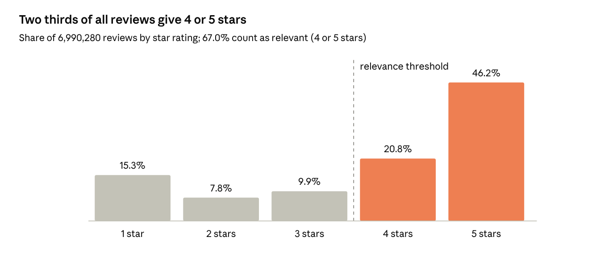{width=6.3in}

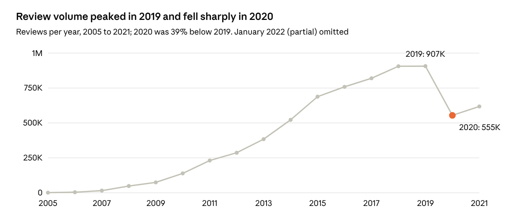{width=6.3in}

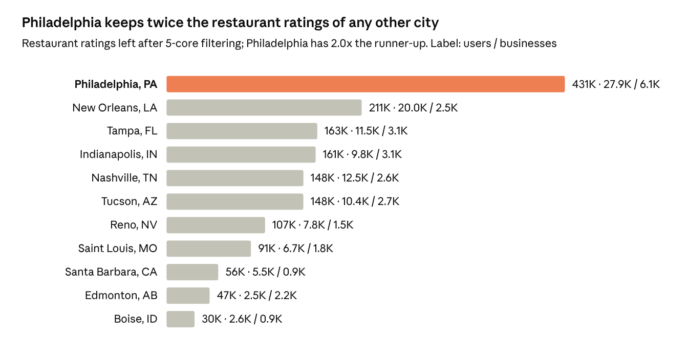{width=6.3in}

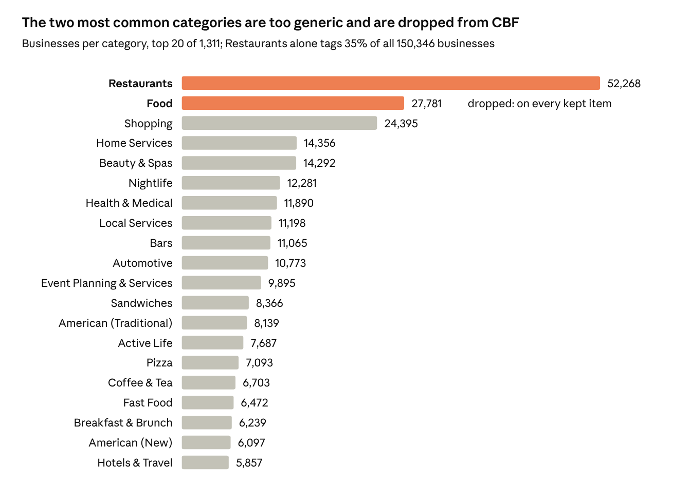{width=6.3in}

The remaining figures use the Philadelphia scope (15 km around City Hall, Restaurants or Food, deduplicated).

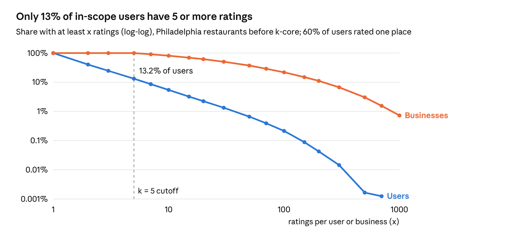{width=6.3in}

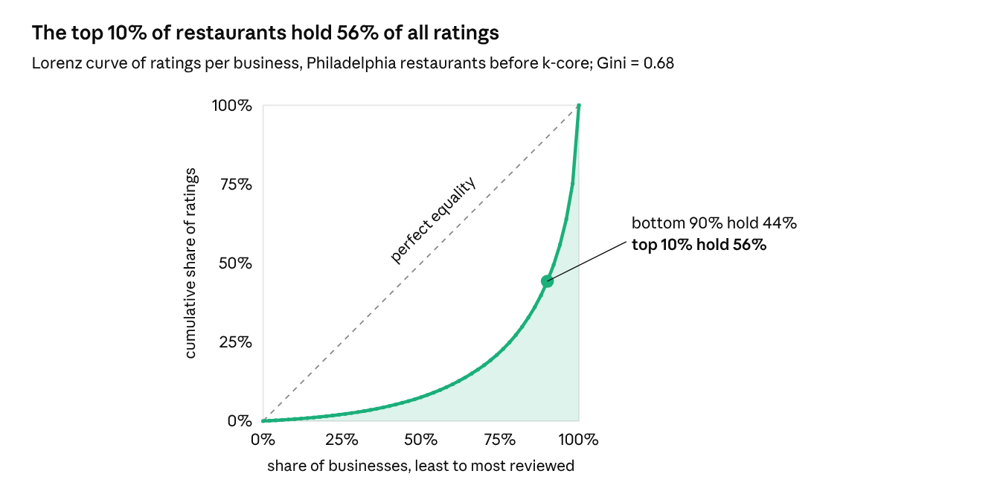{width=6.3in}

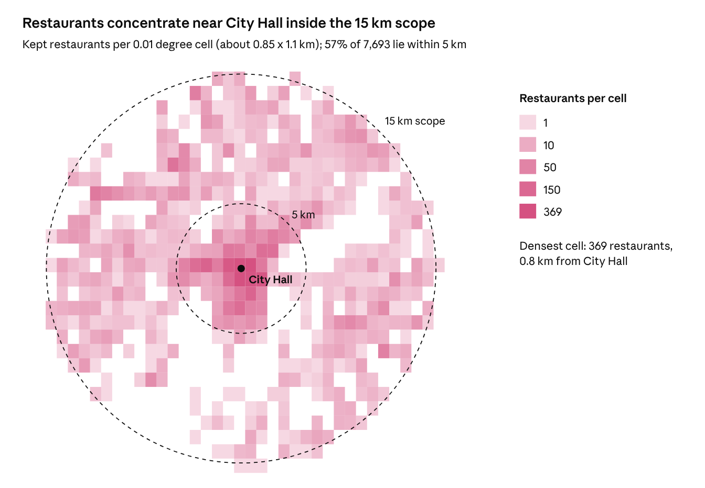{width=6.3in}

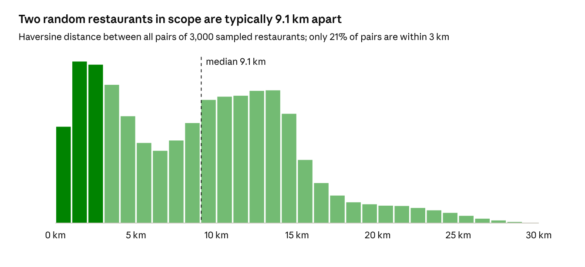{width=6.3in}

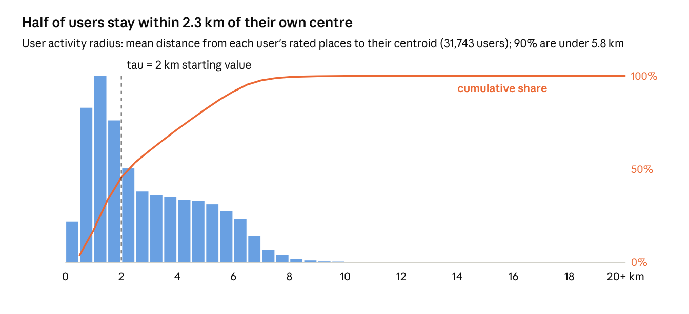{width=6.3in}

The gap between Figure 9 and Figure 10 is the case for distance re-ranking: places are spread about 9 km apart, but users behave locally. The median distance from a user's anchor to the places they rate is 1.4 km, and 90% are within 8.5 km.

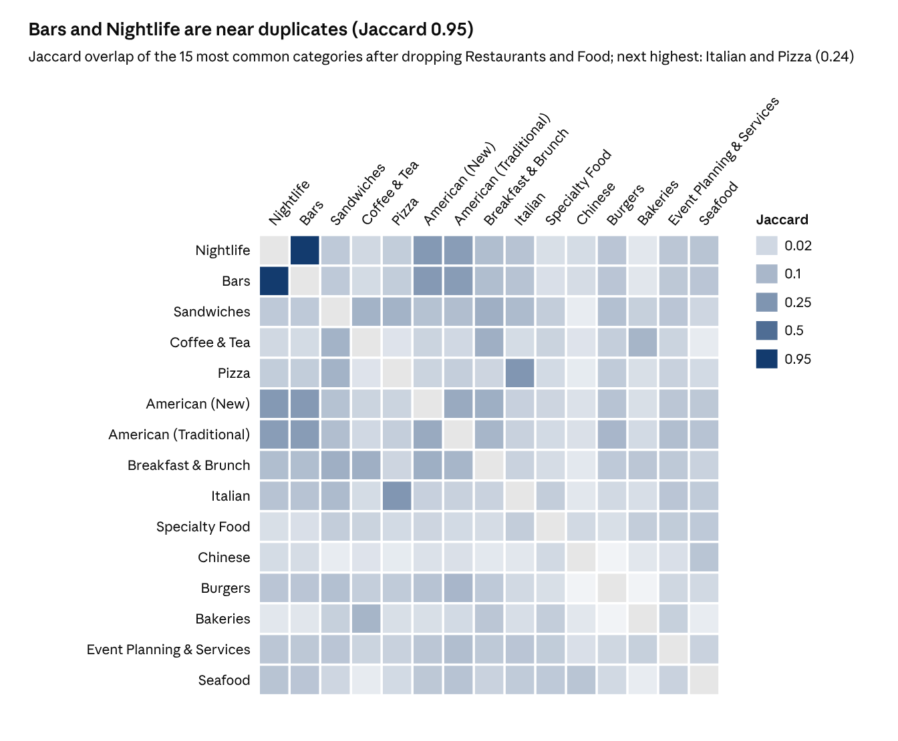{width=6.3in}

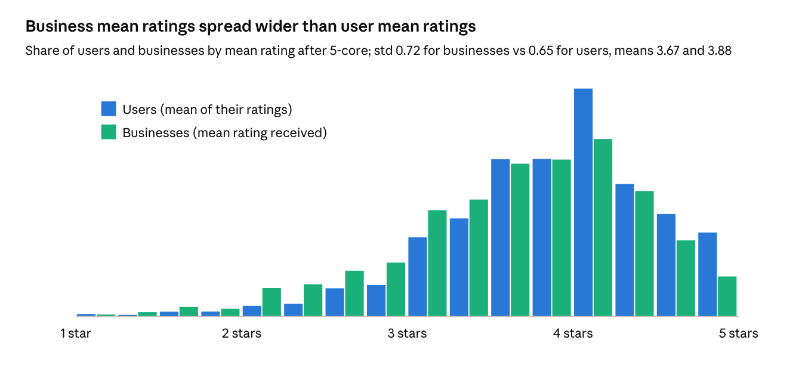{width=6.3in}

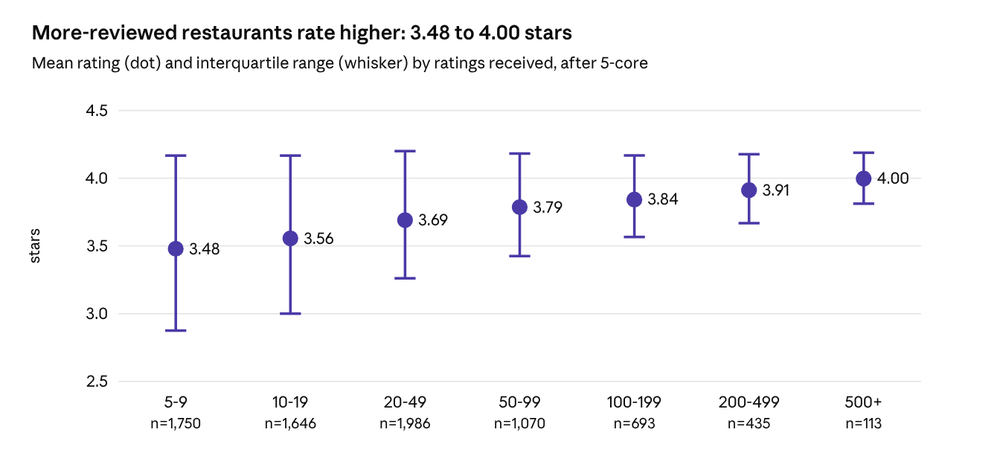{width=6.3in}

Statistics behind these figures:

$$
\bar{F}(x) = P(n_u \ge x) = \frac{1}{|\mathcal{U}|} \sum_{u \in \mathcal{U}} \mathbb{1}[\,n_u \ge x\,], \qquad G = \frac{\sum_{i=1}^{n} (2i - n - 1)\, x_{(i)}}{n \sum_{i=1}^{n} x_{(i)}}
$$

$$
\text{radius}(u) = \frac{1}{n_u} \sum_{i \in \mathcal{I}_u} d\big(c_u, \ell_i\big), \qquad c_u = \frac{1}{n_u} \sum_{i \in \mathcal{I}_u} \ell_i
$$

## 4. Preprocessing

The working set is Philadelphia restaurants within 15 km of City Hall after 5-core filtering: 490,539 ratings, 31,743 users and 7,693 businesses (density 0.20%). The preprocessing script builds it in about 90 seconds.

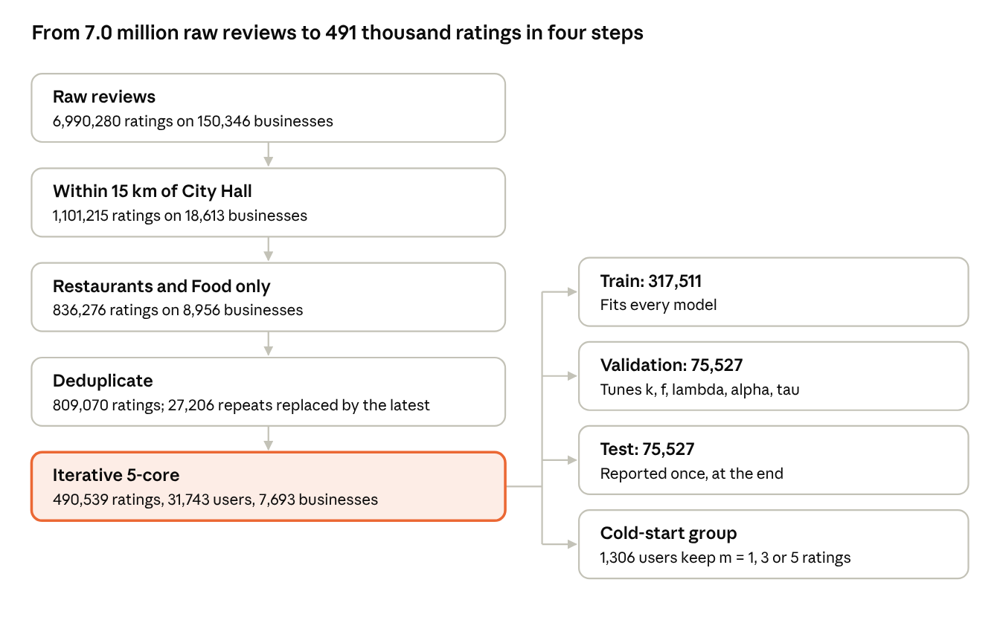{width=6.3in}

| Stage | Ratings | Users | Businesses |
| --- | --- | --- | --- |
| Raw reviews | 6,990,280 | 1,987,929 | 150,346 |
| Within 15 km of City Hall | 1,101,215 | - | 18,613 |
| Restaurants and Food | 836,276 | - | 8,956 |
| Deduplicated (latest kept) | 809,070 | 242,139 | 8,956 |
| 5-core (working set) | 490,539 | 31,743 | 7,693 |

### 4.1 Scope and deduplication

Businesses are kept by radius around the city center instead of the city string, because suburbs are stored as separate cities. When a user reviewed the same business more than once, the most recent rating is kept.

$$
\mathcal{I}_{\text{city}} = \{\, i : d(\ell_i, \ell_{\text{center}}) \le R \,\} \cap \{\, i : \text{Restaurants} \in C_i \ \lor\ \text{Food} \in C_i \,\}, \qquad R = 15 \text{ km}
$$

### 4.2 Iterative k-core filtering

$$
\mathcal{R}_k = \text{largest } \mathcal{R}' \subseteq \mathcal{R} \ \text{ s.t. } \ |\mathcal{I}_u'| \ge k \ \ \forall u, \quad |\mathcal{U}_i'| \ge k \ \ \forall i
$$

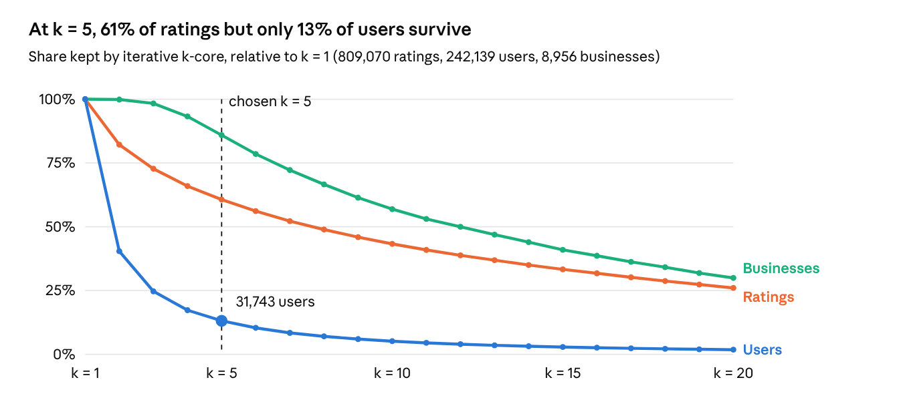{width=6.3in}

### 4.3 Category matrix

Restaurants and Food are dropped, as are categories on fewer than 10 businesses, leaving 188 of 451 in-scope categories. The binary matrix is IDF-weighted and L2-normalized.

$$
X_{ic} = \mathbb{1}[\, c \in C_i \,], \qquad \text{idf}(c) = \log \frac{|\mathcal{I}|}{1 + |\{ i : X_{ic} = 1 \}|}, \qquad \mathbf{x}_i = \frac{\big( X_{ic}\, \text{idf}(c) \big)_{c}}{\big\| \big( X_{ic}\, \text{idf}(c) \big)_{c} \big\|_2}
$$

### 4.4 Split and cold-start group

Each user's ratings are split about 70 / 15 / 15 into train, validation and test, with at least one validation and one test rating per user. Hyperparameters are tuned only on validation; the test set is used once. Because k-core filtering removes exactly the users RQ2 is about, 10% of users with at least 10 ratings (1,306 users) keep only m = 1, 3 or 5 training ratings to simulate new users.

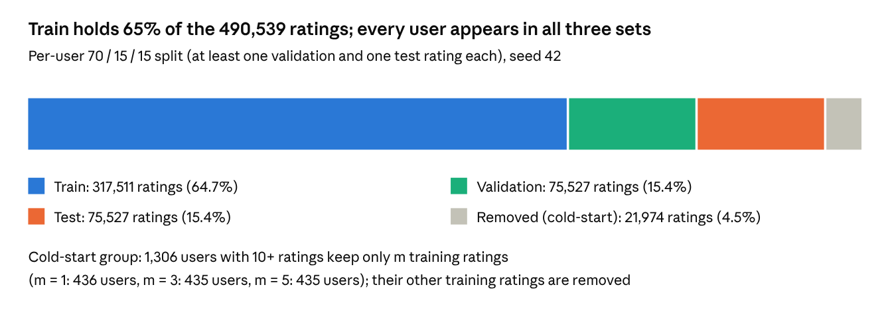{width=6.3in}

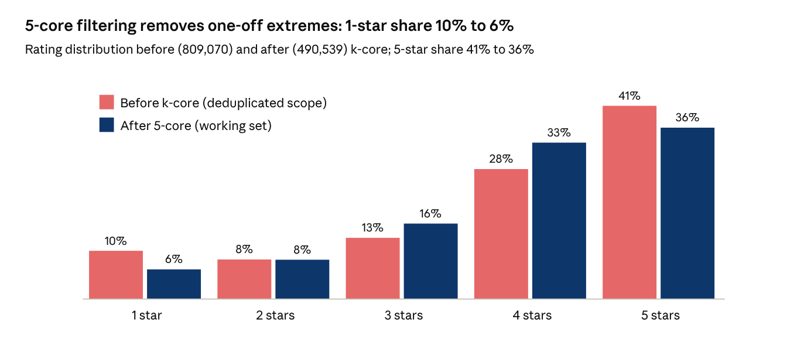{width=6.3in}

## 5. Models

All rating models share one interface (fit on the training ratings, predict a rating for a user-place pair, score every place for a user), train on the same split and are tuned on validation RMSE. Final settings are in Section 9.5.

### 5.1 Baselines

$$
\hat{r}_{ui} = \mu, \qquad b_{ui} = \mu + b_u + b_i
$$

$$
\min_{b_*} \sum_{(u,i) \in \mathcal{R}} \big( r_{ui} - \mu - b_u - b_i \big)^2 + \lambda_u \sum_u b_u^2 + \lambda_i \sum_i b_i^2
$$

$$
b_i = \frac{\sum_{u \in \mathcal{U}_i} (r_{ui} - \mu - b_u)}{\lambda_i + |\mathcal{U}_i|}, \qquad b_u = \frac{\sum_{i \in \mathcal{I}_u} (r_{ui} - \mu - b_i)}{\lambda_u + |\mathcal{I}_u|}
$$

### 5.2 Memory-based CF: item-based kNN

Cosine, adjusted cosine and Pearson similarities were compared, with shrinkage toward zero for items with few co-raters and prediction on top of the bias baseline:

$$
\text{sim}_{\cos}(i,j) = \frac{\sum_{u \in \mathcal{U}_{ij}} r_{ui}\, r_{uj}}{\sqrt{\sum_{u \in \mathcal{U}_{ij}} r_{ui}^2}\ \sqrt{\sum_{u \in \mathcal{U}_{ij}} r_{uj}^2}}, \qquad s_{ij} = \frac{|\mathcal{U}_{ij}|}{|\mathcal{U}_{ij}| + \beta}\ \text{sim}(i,j)
$$

$$
\hat{r}_{ui} = b_{ui} + \frac{\sum_{j \in N_k(i;u)} s_{ij}\, (r_{uj} - b_{uj})}{\sum_{j \in N_k(i;u)} |s_{ij}|}
$$

### 5.3 Model-based CF: matrix factorization

$$
\hat{r}_{ui} = \mu + b_u + b_i + \mathbf{p}_u^{\top} \mathbf{q}_i, \qquad \mathcal{L} = \sum_{(u,i)} \big( r_{ui} - \hat{r}_{ui} \big)^2 + \lambda \Big( b_u^2 + b_i^2 + \|\mathbf{p}_u\|^2 + \|\mathbf{q}_i\|^2 \Big)
$$

Stochastic gradient descent with error e_ui and learning rate eta, early stopping after 3 epochs without validation improvement:

$$
\begin{aligned}
b_u &\leftarrow b_u + \eta\,(e_{ui} - \lambda b_u), \qquad b_i \leftarrow b_i + \eta\,(e_{ui} - \lambda b_i) \\
\mathbf{p}_u &\leftarrow \mathbf{p}_u + \eta\,(e_{ui}\, \mathbf{q}_i - \lambda \mathbf{p}_u), \qquad \mathbf{q}_i \leftarrow \mathbf{q}_i + \eta\,(e_{ui}\, \mathbf{p}_u - \lambda \mathbf{q}_i)
\end{aligned}
$$

### 5.4 Content-based filtering

Each user gets a linear taste vector over the IDF-weighted categories, fitted by ridge regression on what the bias baseline leaves unexplained. A first version centered on the user mean failed for new users (with one rating the user mean is that rating; RMSE 1.50), which is why it is fitted on bias residuals.

$$
\boldsymbol{\theta}_u = \big( X_u^{\top} X_u + \lambda_c I \big)^{-1} X_u^{\top} \big( \mathbf{r}_u - \mathbf{b}_u \big), \qquad \hat{r}^{\text{CBF}}_{ui} = b_{ui} + \boldsymbol{\theta}_u^{\top} \mathbf{x}_i
$$

For RQ2 two richer content models were added: CBF with 42 Yelp place attributes (take-out, ambience, meal times and others, IDF-weighted) and a content-based neighbor model that generalizes from a single rating:

$$
\hat{r}_{ui} = b_{ui} + \frac{\sum_{j \in \mathcal{I}_u} s_{ij}\,(r_{uj} - b_{uj})}{\sum_{j \in \mathcal{I}_u} |s_{ij}| + \text{shrink}}, \qquad s_{ij} = \cos(\mathbf{x}_i, \mathbf{x}_j)
$$

### 5.5 Hybrid

The weight on CF grows with the number of training ratings; kappa is the count at which CF and CBF get equal weight:

$$
\alpha(n_u) = \frac{n_u}{n_u + \kappa}, \qquad \hat{r}_{ui} = \alpha(n_u)\, \hat{r}^{\text{CF}}_{ui} + \big(1 - \alpha(n_u)\big)\, \hat{r}^{\text{CBF}}_{ui}
$$

### 5.6 Candidate generation and popularity blend

Candidates are open places the user has not rated, with at least 20 training ratings (rating models over-score places few users rated). Because rating models predict how much a user would like a place, not whether they would go, the ranking score blends in popularity:

$$
\text{score}_{\text{blend}}(u,i) = \hat{r}_{ui} + \gamma \log\big(1 + |\mathcal{U}_i|\big)
$$

### 5.7 Ranking models: BPR and a learned visit model

BPR learns the ranking of visited over unvisited places directly from pairs (i visited, j not), with mini-batch stochastic gradient ascent and early stopping on validation NDCG@10 (Rendle et al., 2009):

$$
x_{ui} = b_i + \mathbf{p}_u^{\top}\mathbf{q}_i, \qquad \max \sum_{(u,i,j)} \ln \sigma(x_{ui} - x_{uj}) - \frac{\lambda}{2}\big(\|\mathbf{p}_u\|^2 + \|\mathbf{q}_i\|^2 + \|\mathbf{q}_j\|^2 + b_i^2 + b_j^2\big)
$$

The learned visit model replaces the fixed decay rule with logistic regression on distance, personal travel radius rho_u, predicted rating and popularity, trained with our own gradient descent, L2 regularization and backtracking line search:

$$
P(\text{visit} \mid u, i) = \sigma\big(\mathbf{w}^{\top}\mathbf{x}(u,i) + b\big), \quad \mathbf{x} = \big[\log(1+d),\ d,\ \log(1+d/\rho_u),\ \hat{r}_{ui},\ \log(1+\text{pop}_i)\big]
$$

$$
L = -\frac{1}{n}\sum \big[y \log p + (1-y)\log(1-p)\big] + \frac{\lambda}{2}\|\mathbf{w}\|^2, \qquad \nabla_{\mathbf{w}} L = \frac{1}{n} X^{\top}(\mathbf{p} - \mathbf{y}) + \lambda \mathbf{w}
$$

## 6. Distance-aware re-ranking

The candidates are re-scored by multiplying the predicted rating (rescaled to [0, 1]) with a distance weight. The user anchor is the median of the coordinates of the user's training places.

$$
d(\ell_a, \ell_b) = 2 R_E \arcsin \sqrt{ \sin^2\!\Big(\frac{\varphi_b - \varphi_a}{2}\Big) + \cos\varphi_a \cos\varphi_b \sin^2\!\Big(\frac{\lambda_b - \lambda_a}{2}\Big) }, \qquad R_E = 6{,}371 \text{ km}
$$

$$
w_{\exp}(d) = e^{-d / \tau}, \quad w_{\text{gauss}}(d) = e^{-d^2 / (2\sigma^2)}, \quad w_{\text{pow}}(d) = (1 + d / d_0)^{-\gamma}, \quad w_{\text{cut}}(d) = \mathbb{1}[\, d \le D_{\max} \,]
$$

$$
\text{score}(u,i) = \frac{\hat{r}_{ui} - 1}{4} \cdot w\big(d(\ell_u, \ell_i)\big)
$$

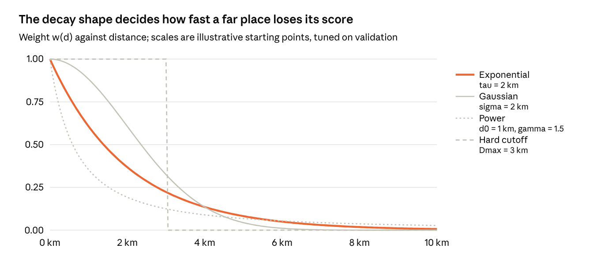{width=6.3in}

Maximal Marginal Relevance (category diversity) and division by a power of popularity were implemented as optional knobs; on this data both cost accuracy and stay off by default.

## 7. Route optimization

The final N places (N = 5 to 8) are ordered to minimize total distance from the start point: an open-path traveling salesman problem.

$$
\pi^\ast = \arg\min_{\pi \in S_N} \Big[ D_{0\,\pi(1)} + \sum_{t=1}^{N-1} D_{\pi(t)\,\pi(t+1)} \Big]
$$

Held-Karp dynamic programming, with C(S, j) the shortest path from 0 that visits exactly S and ends at j:

$$
C(\{j\}, j) = D_{0j}, \qquad C(S, j) = \min_{k \in S \setminus \{j\}} \big[ C(S \setminus \{j\}, k) + D_{kj} \big], \qquad T_{\text{HK}}(N) = O(N^2 2^N)
$$

The heuristic is nearest neighbor followed by 2-opt, which reverses a segment whenever that shortens the path:

$$
\Delta(a, b) = D_{\pi_a \pi_b} + D_{\pi_{a+1} \pi_{b+1}} - D_{\pi_a \pi_{a+1}} - D_{\pi_b \pi_{b+1}} < 0 \ \Rightarrow\ \text{reverse } \pi_{a+1..b}, \qquad \text{gap} = \frac{L_{\text{heur}} - L^\ast}{L^\ast}
$$

Opening hours extend Held-Karp: each state (S, j) keeps the Pareto set of labels (closed visits, finish time), and the objective is lexicographic: fewest visits that arrive at a closed place, then the earliest finish. Travel is at 4.5 km/h, and arriving before opening means waiting:

$$
\text{arrive}_j = \text{end}_k + D_{kj} \cdot \frac{60}{4.5}, \qquad \text{begin}_j = \text{earliest\_start}(j, \text{arrive}_j), \qquad \text{end}_j = \text{begin}_j + \text{stay}
$$

## 8. Evaluation protocol

A test rating of 4 or 5 stars counts as relevant. Top-N metrics use 3,000 sampled warm test users; model differences are tested per user with a paired t-test and a 95% bootstrap interval over users (1,000 resamples).

$$
\text{RMSE} = \sqrt{ \frac{1}{|\mathcal{T}|} \sum_{(u,i) \in \mathcal{T}} \big( r_{ui} - \hat{r}_{ui} \big)^2 }, \qquad \text{MAE} = \frac{1}{|\mathcal{T}|} \sum_{(u,i) \in \mathcal{T}} \big| r_{ui} - \hat{r}_{ui} \big|
$$

$$
\text{Precision@}K = \frac{1}{|\mathcal{U}|} \sum_{u} \frac{|L_u^K \cap \text{Rel}_u|}{K}, \qquad \text{Recall@}K = \frac{1}{|\mathcal{U}|} \sum_{u} \frac{|L_u^K \cap \text{Rel}_u|}{|\text{Rel}_u|}
$$

$$
\text{DCG@}K = \sum_{k=1}^{K} \frac{2^{\,\text{rel}_k} - 1}{\log_2(k + 1)}, \qquad \text{NDCG@}K = \frac{\text{DCG@}K}{\text{IDCG@}K}, \qquad \text{Coverage} = \frac{|\bigcup_u L_u^K|}{|\mathcal{I}|}
$$

$$
t = \frac{\bar{\delta}}{s_{\delta} / \sqrt{n}}, \qquad \delta_u = m_A(u) - m_B(u)
$$

## 9. Results

All numbers are on the test set; every choice was made on validation. Sources are the result files in the repository's results folder.

### 9.1 Rating prediction

| Model | Setting | Test RMSE [95% CI] | MAE | p vs Bias |
| --- | --- | --- | --- | --- |
| Global mean | - | 1.190 [1.182, 1.198] | 0.943 | < 0.001 |
| Bias | lambda = 5 | 1.051 [1.044, 1.059] | 0.818 | - |
| Item-kNN | cosine, k = 80, beta = 0 | 1.121 [1.113, 1.130] | 0.839 | < 0.001 |
| MF (SGD) | f = 10, lambda = 0.1, 15 epochs | 1.052 [1.044, 1.059] | 0.819 | 0.0015 |
| CBF (ridge) | lambda_c = 30 | 1.051 [1.043, 1.059] | 0.818 | 0.81 |
| Hybrid | kappa = 100 | 1.051 [1.044, 1.059] | 0.818 | 0.93 |

The median user has only 6 training ratings, so there is little structure beyond the user and item biases. MF is slightly worse than Bias, and CBF and Hybrid cannot be told apart from it.

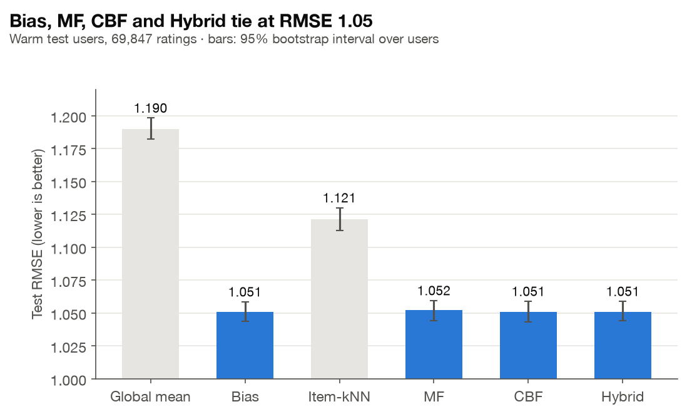{width=6.0in}

### 9.2 Ranking and distance re-ranking (RQ1)

| Method (3,000 test users) | P@10 | NDCG@10 | Mean list distance | Coverage |
| --- | --- | --- | --- | --- |
| Popularity | 0.0094 | 0.0323 | 3.0 km | 0.32% |
| Bias | 0.0005 | 0.0009 | 6.2 km | 4.25% |
| MF | 0.0004 | 0.0011 | 6.3 km | 4.74% |
| CBF | 0.0004 | 0.0008 | 6.2 km | 4.41% |
| Hybrid | 0.0004 | 0.0009 | 6.3 km | 4.30% |
| Hybrid + distance (exp, tau = 2 km) | 0.0018 | 0.0062 | 2.1 km | - |
| Popularity + distance | 0.0100 | 0.0337 | 2.7 km | 0.47% |
| Hybrid blend (gamma = 5) | 0.0095 | 0.0323 | 3.0 km | 0.34% |
| Hybrid blend + distance | 0.0102 | 0.0340 | 2.6 km | 0.55% |

RQ1 expected a trade-off: closer lists, lower accuracy. The opposite happened. Exponential decay with tau = 2 km cuts the Hybrid list's mean distance from 6.3 to 2.1 km and raises NDCG@10 from 0.0009 to 0.0062 (6.9 times). Users mostly rate places near where they already go, so distance is itself a strong relevance signal. The hard cutoff is worse than smooth decay at every radius.

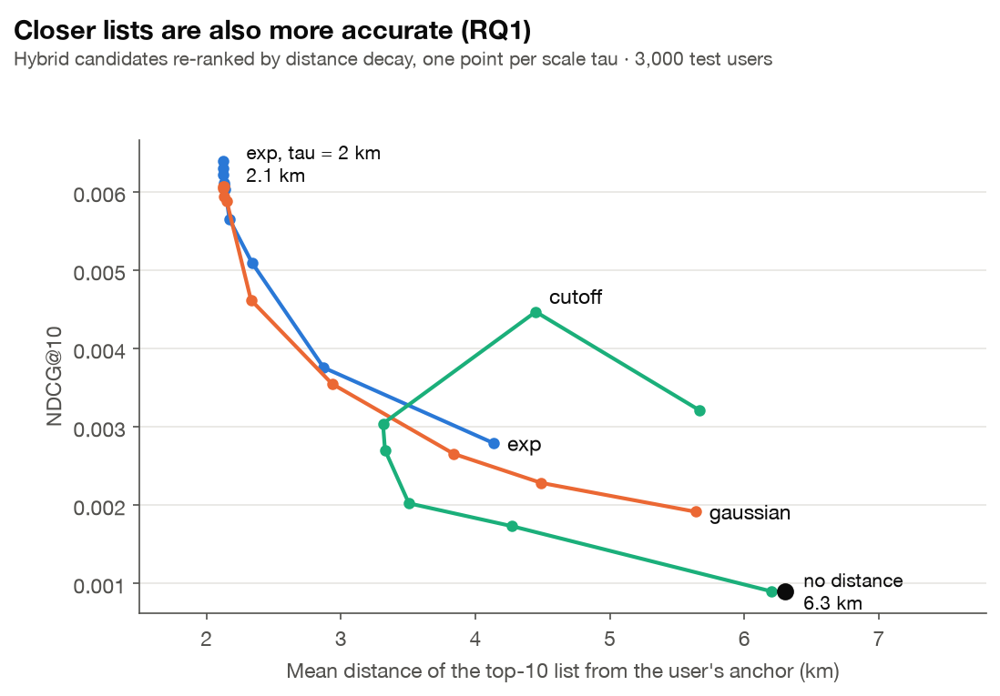{width=6.0in}

Predicted ratings alone do not beat popularity, and a popularity blend plus distance (P@10 0.0102) is practically the same as popularity plus distance (0.0100): the ranking signal in this data comes mostly from popularity and distance.

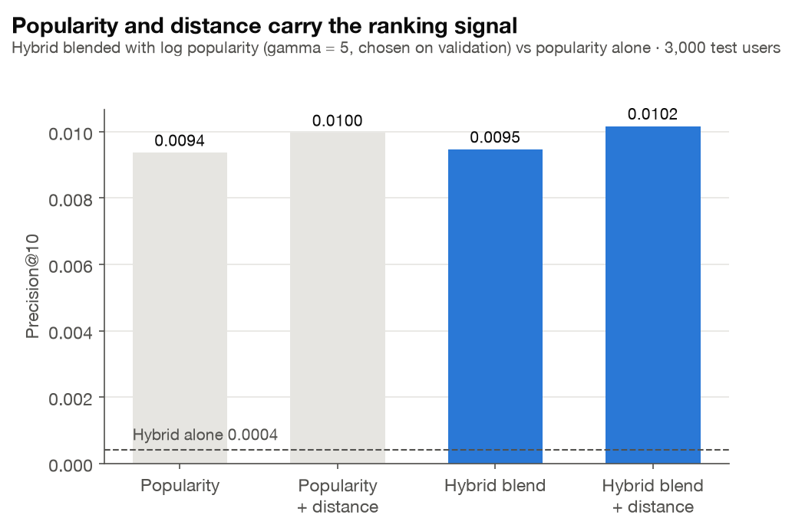{width=5.6in}

The learned visit model (Section 5.7) is significantly more accurate than the earlier fixed setting (NDCG@10 0.0340 → 0.0365, p = 0.003). It is not significantly different from a fixed rule with tau re-tuned on 200 candidates (0.0373, p = 0.36), but it covers more of the catalog (1.26% vs 1.01%, point estimate). Removing the personal travel radius makes it significantly worse.

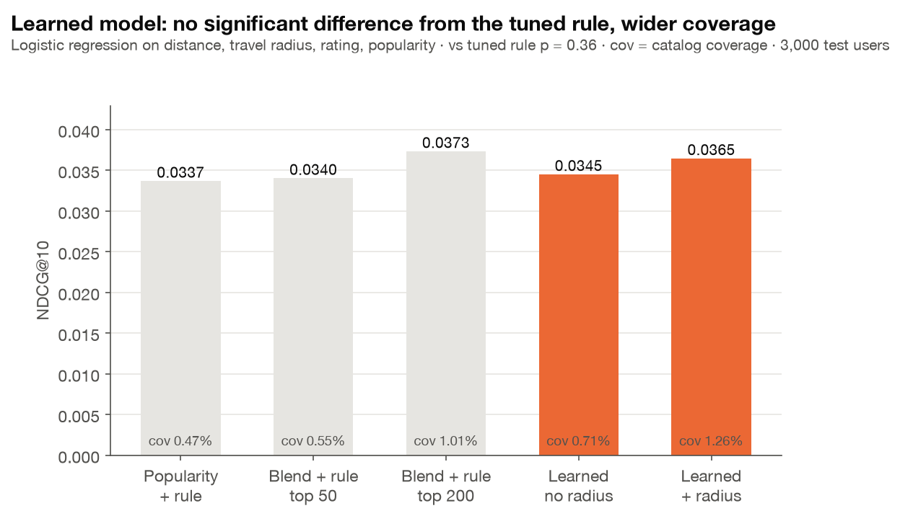{width=5.6in}

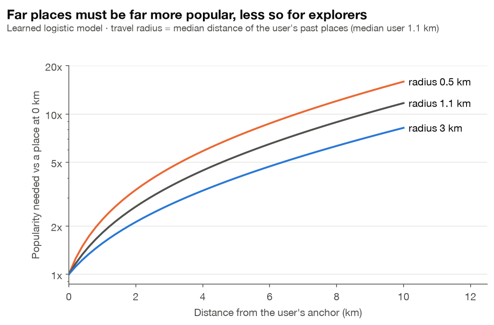{width=5.6in}

BPR, which learns the ranking directly, shows no evidence of beating popularity overall (NDCG@10 0.0326 vs 0.0323, p = 0.61). It was ahead only for users with 21 or more training ratings (0.0419 vs 0.0381, p = 0.03 before correcting for three groups). Changing the objective to ranking does not create a strong personal signal in this data.

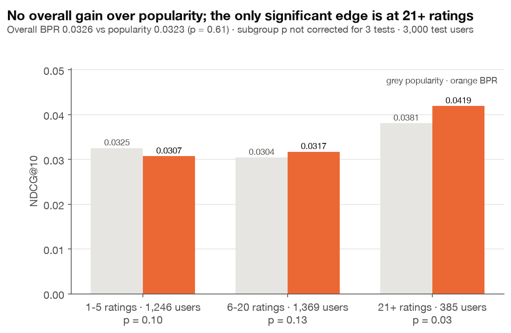{width=5.6in}

### 9.3 Cold start (RQ2)

| Model | m = 1 | m = 3 | m = 5 |
| --- | --- | --- | --- |
| Global mean | 1.131 | 1.148 | 1.151 |
| Bias | 1.069 | 1.026 | 1.039 |
| Item-kNN | 1.245 | 1.213 | 1.152 |
| MF | 1.067 | 1.024 | 1.040 |
| CBF | 1.069 | 1.026 | 1.040 |
| Hybrid | 1.069 | 1.025 | 1.040 |

Test RMSE of the 1,306 simulated new users who keep m training ratings. CBF and Hybrid stay within 0.002 of the bias model. Adding 42 place attributes and the content-based neighbor model did not help either: for both attribute models, validation chose the setting that switches content off as far as the range allowed, and no model differs from Bias (all p ≥ 0.19). The answer to RQ2 is no: in this data, content does not explain a new user's ratings.

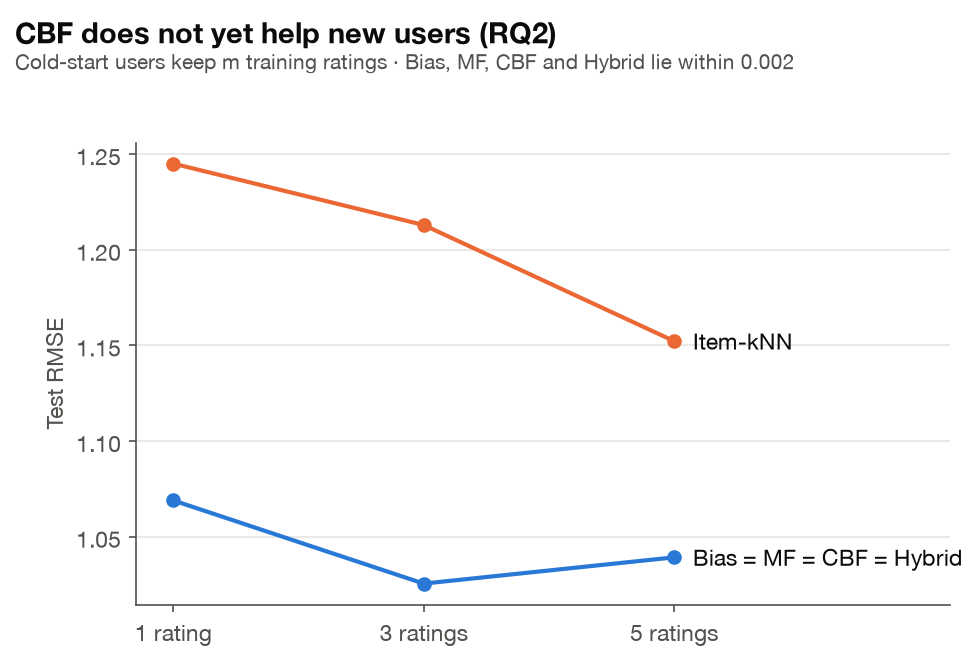{width=5.6in}

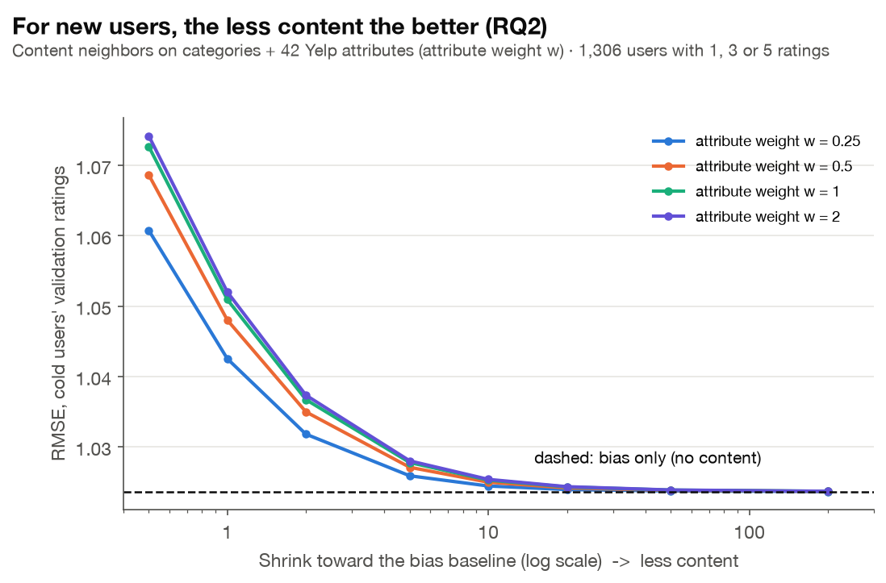{width=5.6in}

### 9.4 Route optimization (RQ3)

| Method (3,000 test users, N = 6) | Exactly optimal | Mean gap to optimum |
| --- | --- | --- |
| Recommendation order | - | median +26% |
| Nearest neighbor | 32.1% | 5.8% |
| NN + 2-opt | 81.9% | 0.9% |
| Held-Karp | 100% | 0% |

Ordering matters even for six nearby places: the optimal order saves a median 1.2 km. Held-Karp takes 0.9 ms for 8 places and 31 ms for 12, while brute force needs 314 ms already at 9, so the exact solver is used in the system and the heuristic is a comparison for RQ3.

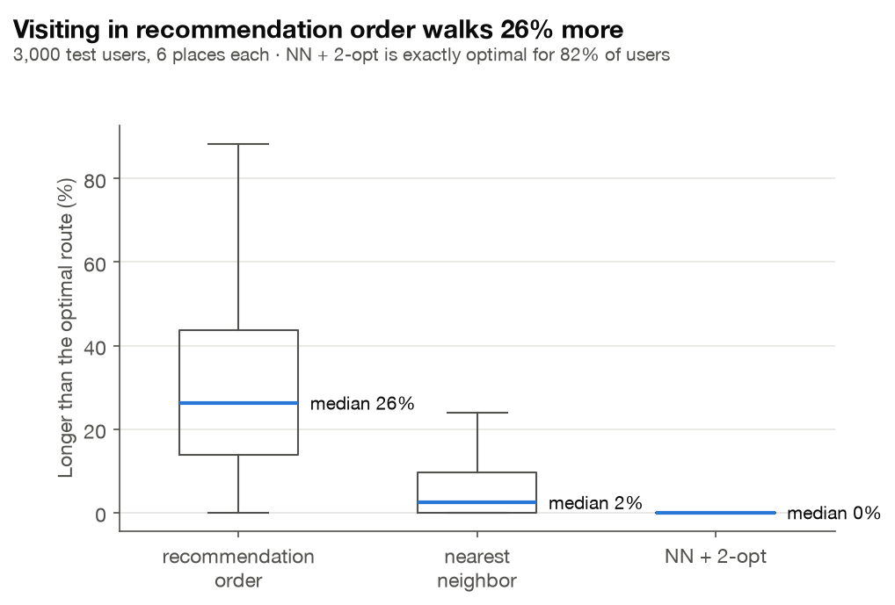{width=5.6in}

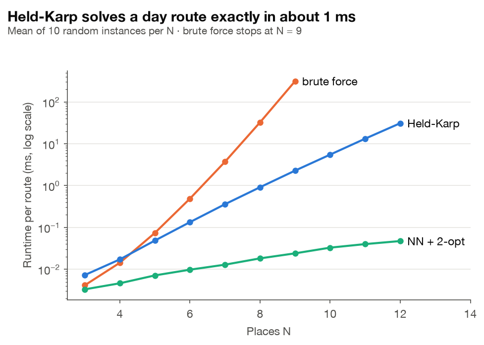{width=5.6in}

Opening hours: on 400 random day plans, the hours-aware Held-Karp cut visits that arrive at a closed place from 272 to 82 (70% fewer, Wilcoxon p < 1e-26). It walks 0.9 km more on average, but waiting time falls by 39 minutes and the day ends 27 minutes earlier.

Walking distance on real streets (OpenStreetMap, Dijkstra): real walks are a median 1.30 times the straight line. For 2,230 Center City test users, re-ranking by walking distance gave no significant accuracy difference (p = 0.61), and the straight-line optimal order is also walking-optimal for 65% of users (mean extra 1.2%, worst 14%). Straight-line distance is a sufficient approximation for the experiments; real streets are needed only for the routes shown to users. These walking numbers were measured before the study-area boundary fix of issue #66 and are marked for re-run in the repository.

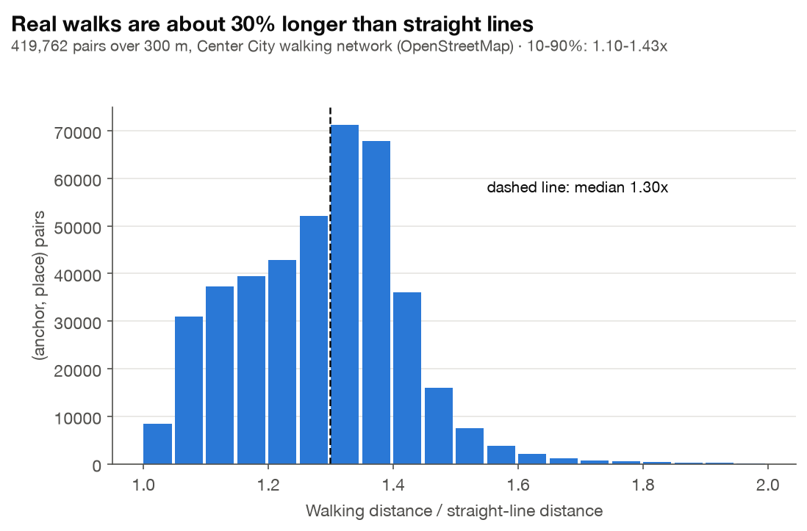{width=5.6in}

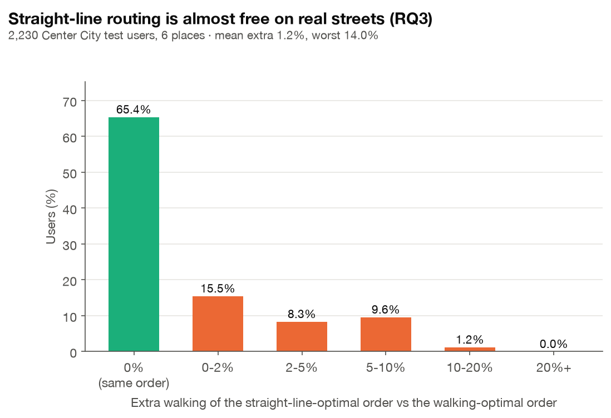{width=5.6in}

The full system on one test user (user 166, anchor 0.5 km south-west of City Hall): the Hybrid prediction is blended with popularity, re-ranked by exponential distance decay, and the six chosen places are ordered by Held-Karp on OpenStreetMap walking distances. The optimal walk is 2.6 km (about 35 minutes at 4.5 km/h) against 4.2 km in recommendation order, and stop 2 (Parc) is a place this user rated 4 or more stars in the held-out test set.

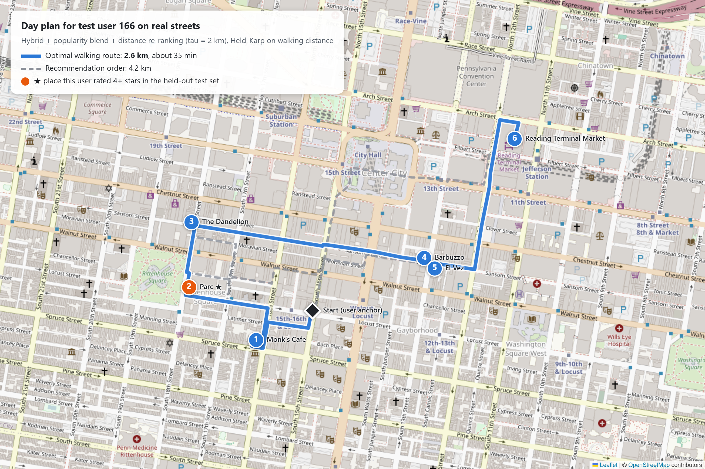{width=6.3in}

### 9.5 Hyperparameter search

| Model | Searched | Best (validation) |
| --- | --- | --- |
| Bias | lambda in {1, 5, 10, 25} | lambda = 5 |
| Item-kNN | similarity (cosine, adjusted cosine, Pearson) x k in {10, 20, 40, 80} x beta in {0, 25, 100} | cosine, k = 80, beta = 0 (val 1.1134) |
| MF (SGD) | f in {10, 20, 50, 100} x lambda in {0.01, 0.02, 0.05, 0.1} | f = 10, lambda = 0.1, eta = 0.01 |
| CBF | lambda_c in {0.3, 1, 3, 10, 30} | lambda_c = 30 |
| Hybrid | fixed alpha in {0, ..., 1}; adaptive kappa in {0.5, ..., 100} | kappa = 100 |
| Distance decay | 4 shapes x tau from 0.5 to 1000 km | exponential, tau = 2 km |
| Popularity blend | gamma in {0, ..., 20} | gamma = 5 |
| BPR | relevance definition x learning rate x f x lambda (24) | ratings >= 4, 0.05, f = 64, lambda = 1e-4 |

MF prefers few factors and strong regularization, the same message as Section 9.1: the data supports little latent structure.

Sensitivity: how much the metric moves across each searched range (best and worst grid point).

| Model | Hyperparameter range | Metric | Best | Worst | Spread |
| --- | --- | --- | --- | --- | --- |
| Bias | lambda 1 to 25 | val RMSE | 1.0443 | 1.0697 | 0.025 |
| Item-kNN | 3 similarities x k x beta (36 runs) | val RMSE | 1.1134 | 1.1761 | 0.063 |
| Item-kNN, cosine only | k x beta (12 runs) | val RMSE | 1.1134 | 1.1456 | 0.032 |
| MF | f 10 to 100 x lambda 0.01 to 0.1 (16 runs) | val RMSE | 1.0455 | 1.0625 | 0.017 |
| CBF | lambda_c 0.3 to 30 | val RMSE | 1.0441 | 1.1106 | 0.066 |
| Hybrid, fixed alpha | alpha 0 to 1 | val RMSE | 1.0441 | 1.0455 | 0.001 |
| Hybrid, adaptive kappa | kappa 0.5 to 100 | val RMSE | 1.0442 | 1.0454 | 0.001 |
| Popularity blend | gamma 0 to 20 | val NDCG@10 | 0.0315 | 0.0019 | 0.030 |
| Distance decay, exponential | tau 0.5 to 1000 km | NDCG@10 | 0.0064 | 0.0028 | 0.004 |
| Distance decay, hard cutoff | radius 0.5 to 1000 km | NDCG@10 | 0.0045 | 0.0009 | 0.004 |

The rating models are most sensitive to regularization (CBF lambda_c, Bias lambda) and to the kNN similarity; MF and the hybrid weight barely move RMSE. Ranking is far more sensitive: gamma = 0 (no popularity) is 16 times worse than gamma = 5, and the exponential decay stays within 0.0006 NDCG@10 of its best for any tau from 0.5 to 10 km, while large tau falls back to the rating order. The decay sweep is computed on the 3,000 evaluation users of Section 9.2 and is shown only as a sensitivity check; tau = 2 km was fixed beforehand from Figure 10.

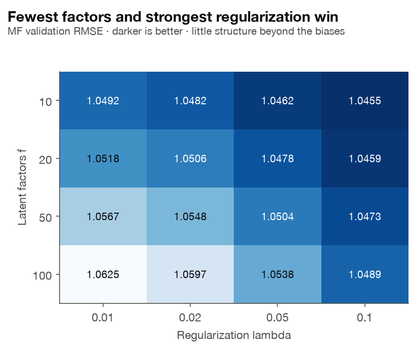{width=5.2in}

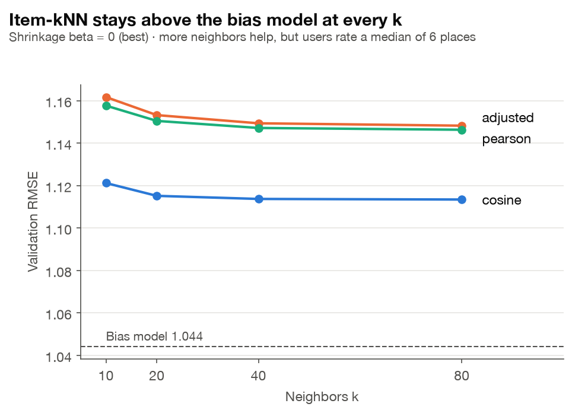{width=5.2in}

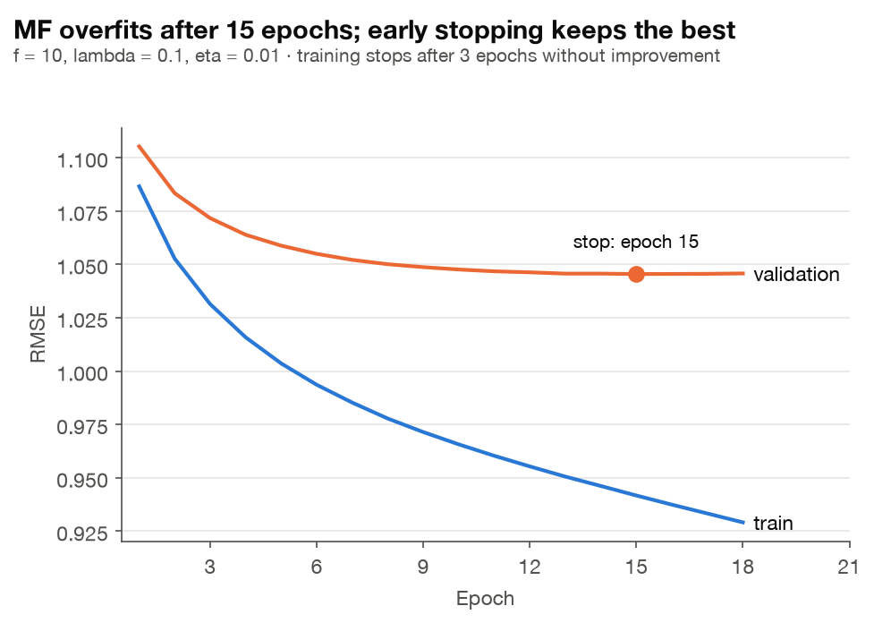{width=5.2in}

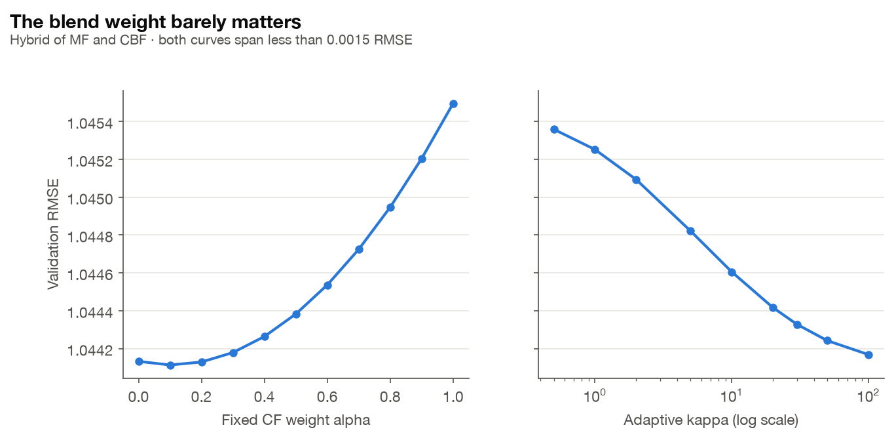{width=6.0in}

### 9.6 Robustness: time-ordered split

The default split shuffles each user's ratings, so 88% of warm users train on a rating newer than one of their test ratings. Re-splitting each warm user by date (oldest about 70% train, newest about 15% test) makes most metrics worse: Bias RMSE 1.051 → 1.108, popularity NDCG@10 0.0323 → 0.0218. The conclusions hold. The four rating models remain within 0.001 of each other, and distance re-ranking still raises Hybrid NDCG@10 (0.0012 → 0.0049) while cutting list distance from 5.0 to 2.3 km. The best method is still the Hybrid blend plus distance (0.0245).

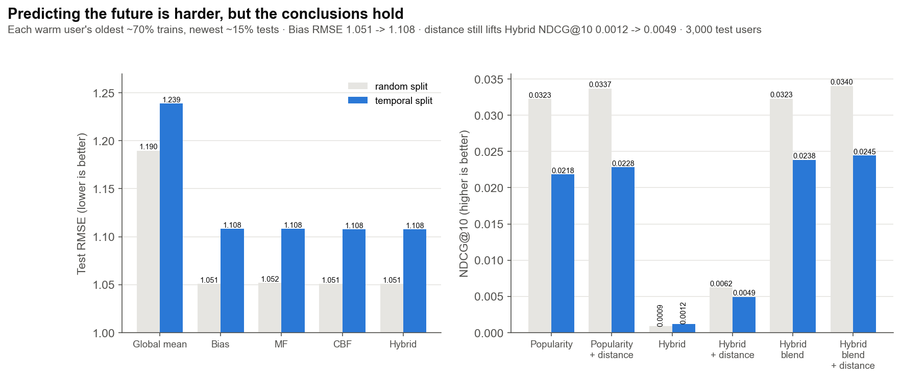{width=6.3in}

### 9.7 Worked example: one user through the pipeline

The figures below come from the first end-to-end prototype run documented in the proposal and illustrate the three stages for one test user with 45 training ratings; their numbers are from that run, not from the final experiments above.

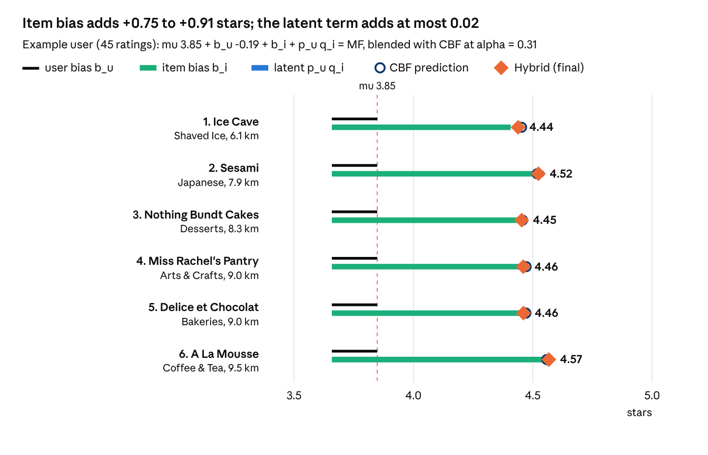{width=6.0in}

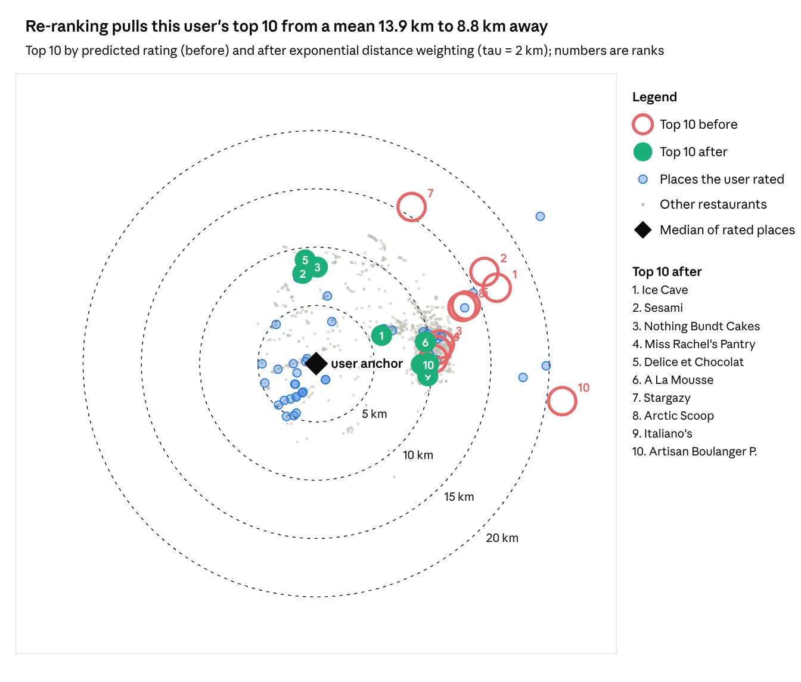{width=5.6in}

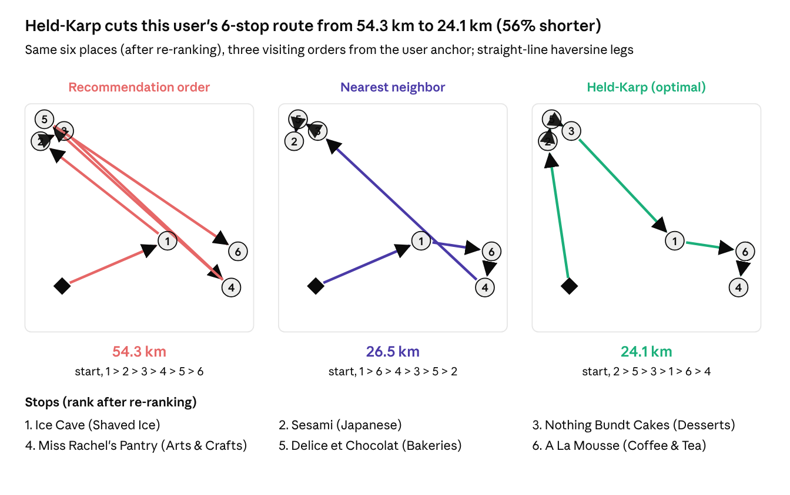{width=6.3in}

## 10. System and open source

| Component | Location | Role |
| --- | --- | --- |
| Data analysis and preprocessing | data_analysis_preprocessing folder | EDA, scope, k-core, split, figures E and P |
| Package | src/tasteroute | data, models (baseline, item_knn, mf, cbf, hybrid, content_knn, visit, bpr), candidates, rerank, geo, roads, route, pipeline, cluster |
| Experiments | experiments folder | one driver script produces every result file and figure, about 6 minutes |
| Demo and dashboard | demo and app folders | Philadelphia bakery tour on real streets; Streamlit dashboard |
| Tests and CI | tests folder, GitHub Actions | pytest on synthetic data, ruff, commit-convention check |

Work followed issue → branch → pull request into the develop branch, with four CI checks and CodeRabbit review required before merge.

The whole study, in pseudocode:

```
Algorithm 1. TasteRoute study
1  R ← Yelp reviews; keep restaurants within 15 km of City Hall
2  keep the latest rating per (user, place); apply 5-core filtering
3  split each user's ratings 70 / 15 / 15 into train / val / test
4  hold out a cold-start group with m ∈ {1, 3, 5} training ratings
5  for each model M in {Bias, Item-kNN, MF, CBF, Hybrid, BPR}:
6      for each setting θ in the grid of M:
7          fit M_θ on train; record the validation metric
8      θ* ← best setting on validation; refit and evaluate once on test
9  for each test user u:
10     C ← open, unseen places with ≥ 20 training ratings
11     s(i) ← r̂_ui + γ log(1 + pop_i) for i ∈ C   # blend
12     s(i) ← s(i) · exp(−d(anchor_u, i) / τ)   # distance
13     L ← top-N places by s
14     route ← Held-Karp(start, L)   # exact order
15 report RMSE, P@K, NDCG@K, route gap; paired t-test and bootstrap CI
```

```
Algorithm 2. Held-Karp for an open path from start 0 through places 1..N
1  for j in 1..N: C[{j}, j] ← D[0, j]
2  for size in 2..N:
3      for each subset S of {1..N} with |S| = size, for j in S:
4          C[S, j] ← min over k in S \ {j} of C[S \ {j}, k] + D[k, j]
5  end ← argmin_j C[{1..N}, j]
6  trace the argmin choices back from end to recover the order
```

## References

- Y. Koren, R. Bell, C. Volinsky, "Matrix Factorization Techniques for Recommender Systems", IEEE Computer 42(8), 30-37, 2009 (bias model, MF and SGD updates)
- A. Au Yeung, "Matrix Factorization: A Simple Tutorial and Implementation in Python", blog post, 2017 (first published 2010), https://albertauyeung.github.io/2017/04/23/python-matrix-factorization.html (MF SGD implementation reference)
- B. Sarwar, G. Karypis, J. Konstan, J. Riedl, "Item-based Collaborative Filtering Recommendation Algorithms", Proc. WWW, 285-295, 2001 (item-kNN similarity)
- Y. Koren, "Factor in the Neighbors: Scalable and Accurate Collaborative Filtering", ACM TKDD 4(1), 1:1-1:24, 2010 (similarity shrinkage, neighbors on a bias baseline)
- S. Rendle, C. Freudenthaler, Z. Gantner, L. Schmidt-Thieme, "BPR: Bayesian Personalized Ranking from Implicit Feedback", Proc. UAI, 452-461, 2009 (BPR)
- J. Carbonell, J. Goldstein, "The Use of MMR, Diversity-Based Reranking for Reordering Documents and Producing Summaries", Proc. SIGIR, 335-336, 1998 (Maximal Marginal Relevance)
- K. Järvelin, J. Kekäläinen, "Cumulated Gain-based Evaluation of IR Techniques", ACM TOIS 20(4), 422-446, 2002 (NDCG)
- M. Held, R. M. Karp, "A Dynamic Programming Approach to Sequencing Problems", J. SIAM 10(1), 196-210, 1962 (Held-Karp)
- G. A. Croes, "A Method for Solving Traveling-Salesman Problems", Operations Research 6(6), 791-812, 1958 (2-opt)
- E. W. Dijkstra, "A Note on Two Problems in Connexion with Graphs", Numerische Mathematik 1, 269-271, 1959 (shortest paths)
- G. Boeing, "OSMnx: New Methods for Acquiring, Constructing, Analyzing, and Visualizing Complex Street Networks", Computers, Environment and Urban Systems 65, 126-139, 2017 (road network download)
- Yelp Open Dataset, https://www.yelp.com/dataset (data; redistribution not allowed, not committed)
- OpenStreetMap contributors, https://www.openstreetmap.org (walking network, ODbL)
